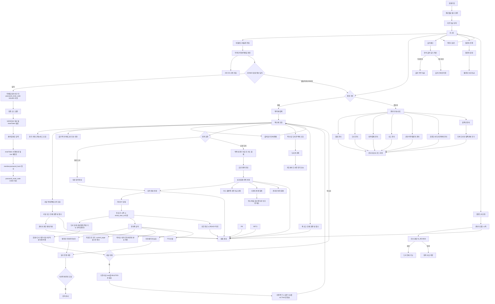

# 전자책 대여 서비스 ERD 설계서

- 작성일: 2026-06-11
- 수정일: 2026-06-22
- 대상 DBMS: MySQL 8.x
- 대상 파일: `ebook-rental-erd.md`
- 설계 목표: 전자책 대여 서비스 요구사항을 기준으로 논리 설계와 물리 설계를 분리하고, 관계형 DBMS(MySQL 8.x)에 적용 가능한 테이블, 관계, 자료형, 제약조건을 DB 명세서 형태로 정리한다.

## 0. 설계 개요

- 이 문서는 요구사항 기반의 관계형 DBMS 설계 문서이며, 기능 흐름과 비즈니스 규칙을 논리 모델과 물리 모델로 추적 가능하게 정리한다.
- 논리 설계는 엔티티의 업무 의미, 주요 속성 의미, 테이블 간 관계, 1:1/1:N/N:M 관계, N:M 해소용 매핑 테이블 기준을 정의한다.
- 물리 설계는 실제 테이블명, 컬럼명, 자료형, 사이즈, NULL 허용 여부, PK/FK/UNIQUE/CHECK 제약, 기본값, 컬럼 설명을 MySQL 8.x 기준으로 정의한다.
- 이 문서는 별도 데이터 사전, API 절차 문서, CSV 절차 문서, 통계 전용 문서를 새로 만들지 않고 ERD 문서 안에서 필요한 기준만 명시한다.
- 기존 `user_reading_statistic`, `admin_statistic`는 현행 집계 테이블로 유지할 수 있으나, 신규 통계 테이블, 세로형 통계 테이블, 신규 Master-Detail 구조는 추가하지 않는다.

## 1. 설계 범위

- 회원가입, 로그인, 비밀번호 변경/재설정, 아이디 찾기, 회원정보 관리, 등급, 출석, 포인트를 관리한다.
- 책 조회, 카테고리, 장르 키워드/해시태그, 텍스트 페이지 본문, 뷰어, 북마크를 관리하고 자동 페이지 넘김을 제공한다.
- 무료/유료 도서 대여, 첫 읽기 시작, 소장, 카드 결제, 쿠폰/포인트 차감을 관리한다.
- 쿠폰, 챌린지, 희망도서 신청, 시리즈/이벤트 컬렉션, 책 보유 도서관 위치를 관리한다.
- 도서 상세 화면의 리뷰 목록/평점 요약, 첫 읽기 시작 후 리뷰/별점 작성, 즐겨찾기, 책/리뷰 신고와 제재 이력을 관리한다.
- 알림과 공지는 DB에 저장한다.
- 사용자 통계는 전자책 완독 권수 기준 탄소 배출 감소량과 나무 보호량을 계산값으로 표시한다.
- 관리자 통계는 운영 지표 집계만 관리한다.
- 채팅은 다른 방식으로 구현하므로 DB 설계에서 완전히 제외한다.
- 데이터 사전, API/CSV 처리 절차, 별도 통계 문서 작성은 이번 설계 범위에서 제외한다.

## 2. MySQL 설계 기준

### 2.1 논리 설계 기준

| 구분 | 기준 |
| --- | --- |
| 설계 단위 | 요구사항과 비즈니스 규칙에서 식별한 업무 엔티티를 기준으로 한다. |
| 엔티티 의미 | 각 엔티티는 회원, 도서, 대여, 결제, 리뷰처럼 업무에서 독립적으로 식별되는 의미를 가진다. |
| 주요 속성 의미 | 주요 속성은 업무에서 어떤 값을 표현하는지 설명할 수 있어야 하며, 단순 화면 표시용 임시 값은 저장하지 않는다. |
| 관계 | 테이블 관계는 부모/자식 의미, 1:1, 1:N, N:M cardinality, 필수/선택 참여 여부를 구분한다. |
| N:M 해소 | N:M 관계는 직접 연결하지 않고 매핑 테이블로 해소하며, 매핑 테이블은 양쪽 FK와 필요한 UNIQUE 제약을 가진다. |
| 정규화 | 기본 구조는 3정규화를 따른다. 집계 성능이나 화면 요구로 유지하는 기존 집계 테이블은 예외로 명시한다. |
| 통계 | 기존 `user_reading_statistic`, `admin_statistic`는 기존 집계 테이블로 유지할 수 있으나 신규 통계 테이블이나 세로형 통계 테이블은 추가하지 않는다. |
| 제외 구조 | 신규 Master-Detail 구조는 추가하지 않는다. |

### 2.2 물리 설계 기준

| 구분 | 기준 |
| --- | --- |
| DBMS | MySQL 8.x |
| 물리 명세 항목 | 실제 테이블명, 컬럼명, 자료형, 사이즈, NULL 허용 여부, PK/FK/UNIQUE/CHECK 제약, 기본값, 컬럼 설명을 명세한다. |
| PK | 대리키는 `BIGINT UNSIGNED AUTO_INCREMENT`를 기본으로 한다. |
| FK | 참조 대상 PK와 동일하게 `BIGINT UNSIGNED`를 사용하고, 가능한 경우 FK 컬럼명은 참조 PK 컬럼명과 동일하게 맞춘다. |
| 상태값 | MySQL 호환성과 확장성을 위해 별도 코드 테이블 없이 `VARCHAR` + `CHECK` 기준으로 명세한다. |
| 문자셋 | `utf8mb4` 기준 |
| 기준정보 삭제 | 기준정보는 물리 삭제 대신 각 테이블의 상태 컬럼으로 관리한다. 예: `publisher_status`, `author_status`, `category_status`, `coupon_status` |

### 2.3 테이블명 명명 규칙

| 구분 | 기준 |
| --- | --- |
| 형식 | 물리 테이블명은 lowercase snake_case를 사용한다. |
| 단수형 | 테이블명은 복수형이 아니라 단수형 업무 명사를 사용한다. |
| 의미 | 테이블명은 업무 의미를 드러내며 불명확한 약어를 사용하지 않는다. |
| 매핑 테이블 | N:M 매핑 테이블은 양쪽 엔티티명을 조합한 lowercase snake_case 단수형 이름을 사용한다. |

### 2.4 컬럼명 명명 규칙

| 구분 | 기준 |
| --- | --- |
| 형식 | 컬럼명은 lowercase snake_case를 사용한다. |
| 패턴 | 컬럼명은 업무 단어와 도메인 키워드를 조합해 의미를 드러낸다. |
| 도메인 키워드 단독 사용 | `status`, `type`, `count`, `payment_amount`, `price`, `rate`, `yn`처럼 단독 사용 시 의미가 모호한 도메인 키워드는 `member_status`, `publisher_status`, `book_status`, `review_status`처럼 업무 단어를 앞에 붙인다. |
| PK | PK는 테이블 의미를 포함한 식별자 컬럼을 사용한다. |
| FK | FK 컬럼은 적용 가능한 경우 참조 대상 PK 컬럼명과 동일하게 사용해 `id`, `no`, `num` 혼용을 피한다. |
| 시간 컬럼 | 날짜만 저장하면 `_date`, 시각까지 저장하면 `_at` suffix를 사용한다. |
| 여부 컬럼 | 여부 값은 `_yn` suffix를 사용한다. |

### 2.5 약어 및 도메인 키워드 기준

| 구분 | 기준 |
| --- | --- |
| 약어 | 일반적으로 통용되지 않는 약어는 사용하지 않는다. 필요한 경우 문서 안에서 의미를 먼저 고정한다. |
| 도메인 키워드 | 식별자는 `_id`, 날짜는 `_date`, 일시는 `_at`, 상태는 `_status`, 유형은 `_type`, 수량은 `_count`, 금액은 `_amount` 또는 `_price`, 비율은 `_rate`, URL은 `_url`, 여부는 `_yn`을 사용한다. 이미 `rental_status`, `payment_status`, `coupon_status`처럼 업무 단어와 도메인 키워드가 결합된 컬럼은 더 길게 바꾸지 않는다. |
| 일시 컬럼 | `created_at`, `updated_at`, `withdrawn_at`, `deactivated_at`, `anonymized_at`, `paid_at`, `issued_at`, `used_at`, `expires_at`처럼 행위 또는 감사 의미가 명확한 일시 컬럼은 테이블명을 반복해 붙이지 않는다. 같은 테이블 안에 같은 도메인의 일시 컬럼이 여러 개 있어 의미가 모호한 경우에만 업무 단어를 추가한다. |
| ISBN | ISBN은 국제 표준 식별자이므로 `isbn` 키워드를 그대로 사용한다. |
| 본문 | 전자책 본문은 `page_content`처럼 내용 의미와 저장 단위를 함께 드러낸다. |

### 2.6 자료형 및 사이즈 기준

| 구분 | 기준 |
| --- | --- |
| PK/FK | `BIGINT UNSIGNED` |
| ISBN | `CHAR(13)` 또는 `VARCHAR(13)` |
| 금액 | 원화 정수 금액은 `INT` 또는 `BIGINT` |
| 건수/수량 | `INT` |
| 비율 | `DECIMAL(5,2)` |
| 평균 별점 | `DECIMAL(3,2)` |
| 여부 | `TINYINT(1)` |
| 날짜 | `DATE` |
| 일시 | `DATETIME` |
| URL | `VARCHAR(500)` |
| 짧은 코드/상태 | `VARCHAR(20~30)` |
| 이름/제목 | `VARCHAR(100~255)` |
| 설명 | `TEXT` |
| 전자책 본문 | `LONGTEXT` |

## 3. 비즈니스 규칙

> BR 번호는 고정 식별자다. 기능별 가독성을 위해 묶음만 변경하며, 번호 순서는 연속되지 않을 수 있다.

### 3.1 회원 / 인증

| 번호 | 규칙 |
| --- | --- |
| BR-01 | 회원가입 시 생년월일은 필수다. |
| BR-02 | 회원 상태는 `JOINED`, `SANCTIONED`, `WITHDRAWN`, `DEACTIVATED`를 사용한다. |
| BR-03 | 회원 탈퇴/삭제는 물리 삭제하지 않고 탈퇴 상태, 비활성 시각, 탈퇴 시각, 비식별화 시각으로 관리한다. |
| BR-04 | 비밀번호 재설정은 `password_reset_code`로 이메일 인증 코드 상태를 관리하고, 최종 비밀번호는 `member.password_hash` 갱신으로 처리한다. 별도 비밀번호 이력 테이블은 만들지 않는다. `resetToken`, 공통 응답, 재발송 제한, row 정리 정책은 `13.12 비밀번호 재설정 정책`을 따른다. |
| BR-05 | 회원 등급은 쿠폰/포인트 차감 후 카드 결제액 기준으로 산정한다. 등급 유지 종료일과 등급 산정 시작일은 `member`에 저장하고, 등급 변경 이력 테이블은 만들지 않는다. |
| BR-06 | 등급 변경 이력 테이블은 만들지 않는다. |

### 3.2 대여

| 번호 | 규칙 |
| --- | --- |
| BR-07 | 무료 도서는 결제 없이 대여할 수 있고, 유료 전환은 도서 정책으로 처리한다. |
| BR-09 | 무료/유료 도서 모두 동시 대여 가능 인원 제한이 없다. |
| BR-34 | 전자책 완독은 책의 마지막 페이지에 도달한 시점으로 판정한다. |
| BR-40 | 대여 상태는 `READY`, `READING`, `OWNED`만 사용한다. `book_rental.rental_start_at`은 첫 읽기 시작 시점에 저장하며 읽기 전에는 `NULL`이다. |
| BR-41 | 반납, 연체, 연체료, 연체료 차감 포인트/쿠폰 정책은 구현하지 않는다. 대여 기간 종료 후에는 `READY` 상태로 돌아가며 다시 대여할 수 있다. |
| BR-42 | 소장 기능은 `OWNED` 상태로 분리하고, 연장 이력은 저장하지 않으며 `book_rental.rental_end_at`만 갱신한다. |

### 3.3 결제

| 번호 | 규칙 |
| --- | --- |
| BR-08 | 유료 도서는 카드 결제 완료 후 대여를 생성한다. 쿠폰과 포인트는 결제수단이 아니라 할인/차감 수단이다. |
| BR-10 | 결제는 완료 이력만 저장하며 실패, 취소, 환불, 복구 이력은 저장하지 않는다. 카드 결제는 더미 결제로 처리해 결제 실패 개념을 두지 않는다. |
| BR-11 | 결제수단은 `CARD`만 사용한다. 할인 전 금액과 최종 카드 결제 금액을 저장하며, 100% 쿠폰 또는 포인트 전액 차감으로 최종 결제 금액이 0원이 되어도 `payment` row를 저장한다. |

### 3.4 포인트 / 쿠폰 / 등급

| 번호 | 규칙 |
| --- | --- |
| BR-12 | 쿠폰 기능은 구현하며 쿠폰 정의, 회원 보유 쿠폰, 사용 이력을 분리하고 쿠폰 1장당 사용 이력 1개를 허용한다. |
| BR-13 | 쿠폰 유효기간은 2주이며, % 할인 쿠폰과 금액 할인 쿠폰을 모두 지원한다. 같은 결제에 쿠폰은 중복 사용할 수 없다. 만료 관리는 쿠폰에만 적용하며 회원 쿠폰 만료일은 `member_coupon.expires_at`으로 관리한다. |
| BR-15 | 포인트는 챌린지, 리뷰 작성, 결제 페이백, 이벤트, 관리자 조정으로 적립하고 결제 차감에 사용한다. 포인트는 만료되지 않으며 소멸예정 포인트 기능, `point_history.expires_at`, 포인트 lot/잔여량 추적 테이블은 만들지 않는다. `member.point_balance`는 `point_history`와 같은 트랜잭션에서 갱신한다. |
| BR-32 | 출석체크 보상은 쿠폰으로 지급한다. 7일 연속 출석은 5% 할인 쿠폰, 30일 연속 출석은 10% 할인 쿠폰을 지급하며 생일 쿠폰은 로그인 시 지급한다. |

### 3.5 희망도서 신청

| 번호 | 규칙 |
| --- | --- |
| BR-16 | 희망도서 신청은 후보 단위로 집계한다. `book_request_candidate`에 후보와 신청자 수를 저장하고, 후보 상태는 `REQUESTED`(신청), `IN_REVIEW`(검토 중), `APPROVED`(승인), `REJECTED`(반려)를 사용한다. 관리자 검토 시작 시 `book_request_candidate.candidate_status`를 `IN_REVIEW`로 변경한다. `book_request.request_status`는 회원별 신청 row의 최종 처리 상태로 `REQUESTED`, `APPROVED`, `REJECTED`만 사용하며, 사용자 화면의 검토 중 표시는 후보 상태를 조인해서 보여준다. |

### 3.6 도서 / 카탈로그 / 도서관

| 번호 | 규칙 |
| --- | --- |
| BR-17 | 전자책 서비스에서 책이 있는 도서관 위치만 제공하며 실제 도서 대여 기능은 구현하지 않는다. 도서관 목록에서 특정 도서관을 선택하면 지도에서 위치를 표시한다. |
| BR-18 | 도서관 좌표는 API로 받은 위도/경도를 저장할 수 있으며 좌표 미확보 상태를 위해 `NULL`을 허용한다. |
| BR-22 | 추천은 같은 작가/같은 카테고리/같은 장르 키워드 기준의 단순 쿼리로 처리하고 추천 로그는 저장하지 않는다. |
| BR-38 | 장르 키워드와 해시태그는 책과 N:M으로 연결해 목록/상세 필터와 표시에서 사용한다. |
| BR-43 | 도서 검색 대상에는 제목, 저자, 출판사를 포함한다. `book.rental_count`, `book.average_rating`, `book.review_count`는 실시간 갱신 집계값으로 저장한다. |
| BR-46 | 시리즈와 이벤트는 `collection`으로 관리하고, 등록 도서와 컬렉션은 `collection_book`으로 연결한다. 시리즈는 순서가 있는 책 묶음이고 이벤트는 순서 없는 책 묶음이며, 구분은 `collection.collection_type`으로 한다. |

### 3.7 뷰어 / 독서 진행 / 북마크

| 번호 | 규칙 |
| --- | --- |
| BR-19 | 북마크는 필수 뷰어 기능으로 제공하며 같은 대여 건의 같은 페이지에는 북마크를 1개만 허용한다. 북마크 메모는 저장하지 않는다. |
| BR-20 | 자동 페이지 넘김 시간, 스크롤/페이지 넘김 모드, 글씨 크기, 다크/라이트 모드, 전체화면/읽기 모드는 DB에 저장하지 않는다. |
| BR-21 | TTS는 보류하며 도서별 TTS 가능/불가 여부는 저장하지 않는다. |
| BR-50 | 다음/이전 페이지, 처음으로 가기, 현재 페이지/전체 페이지 표시를 제공한다. 처음으로 가기를 실행하면 `reading_progress.current_page`를 1로 갱신한다. |
| BR-39 | 읽기 진행, 리뷰, 북마크는 대여 건(`rental_id`) 중심으로 연결해 회원/책 정보 중복 저장을 줄인다. 북마크는 책 자체가 아니라 대여 건 기준이며, 한 대여 건 안에서 여러 페이지에 만들 수 있고 같은 페이지에는 1개만 허용한다. |
| BR-51 | 책 본문은 `book_page.page_content`에 텍스트로만 저장하고, 뷰어는 `book_page`를 `page_no` 기준으로 조회한다. 본문 이미지, 페이지 이미지, PDF/EPUB/IMAGE 파일 기반 뷰어는 범위에서 제외한다. |
| BR-52 | 책 표지 이미지는 본문 이미지가 아니며 `book.cover_image_url`로 관리한다. 도서관 정보나루 API의 `bookImageURL`을 저장해 목록/상세/대여/뷰어 상단 표지로 사용할 수 있다. |

### 3.8 통계 / 챌린지

| 번호 | 규칙 |
| --- | --- |
| BR-14 | 챌린지 기능은 일일/전체 유형만 구현하며 챌린지 정의, 진행 상태, 보상, 보상 수량을 분리한다. 전체 챌린지는 가입 이후 1회만 달성할 수 있다. |
| BR-23 | 사용자 통계와 관리자 통계는 별도 집계 테이블에 저장하며 기간별 중복 row를 UNIQUE 제약으로 방지한다. |
| BR-24 | 탄소 배출 감소량은 전자책 완독 권수 x 2kg CO2, 나무 보호량은 전자책 완독 권수 x 0.04그루로 계산하며, 계산값 자체는 DB에 저장하지 않는다. |
| BR-47 | 나이대별 대여 현황은 `member.birth_date` 기준으로 10대, 20대, 30대, 40대, 50대 이상으로 집계한다. |

### 3.9 알림 / 공지

| 번호 | 규칙 |
| --- | --- |
| BR-25 | 알림은 유형, 제목, 연결 대상, 읽음 여부만 저장하며 알림 본문과 채널별 발송 이력은 저장하지 않는다. 알림은 생성 후 한 달이 지나면 물리 삭제한다. 공지는 알림 생성 여부를 `notice.notify_yn`에 저장한다. |
| BR-48 | 대여 만료 알림은 대여 종료 1일 전이고 마지막 페이지 미도달 상태일 때 생성한다. 공지 수정 시에는 알림을 재발송하지 않는다. |

### 3.10 제외 기능

| 번호 | 규칙 |
| --- | --- |
| BR-26 | 채팅 테이블은 만들지 않는다. |

### 3.11 리뷰 / 신고 / 관리자 처리

| 번호 | 규칙 |
| --- | --- |
| BR-27 | 리뷰는 도서 상세 화면에서 조회하고 작성한다. |
| BR-28 | 회원은 해당 도서를 처음 읽기 시작한 시점(`book_rental.rental_start_at`)부터 리뷰와 별점을 작성할 수 있다. |
| BR-29 | 전자책 뷰어에서는 리뷰를 작성하지 않는다. |
| BR-30 | 신고는 별도 신고 화면을 만들지 않고, 현재 조회 중인 화면 안의 신고 입력 영역 또는 모달에서 접수한다. |
| BR-31 | 같은 사용자가 같은 대상을 여러 번 신고할 수 있다. |
| BR-35 | 리뷰 UNIQUE 정책은 `UNIQUE(member_id, book_id)`로 변경해 회원 1명이 같은 책에 리뷰 1개만 작성할 수 있게 한다. |
| BR-36 | 리뷰 삭제는 물리 삭제하지 않고 `review.review_status = 'DELETED'`로 숨김 처리한다. 삭제된 리뷰는 작성자가 같은 row를 수정한 뒤 `ACTIVE`로 복구할 수 있다. |
| BR-37 | 관리자 숨김은 `review.review_status = 'HIDDEN'`, 사용자 삭제는 `review.review_status = 'DELETED'`로 구분한다. |
| BR-44 | 별점은 `rating` 테이블로 분리하고 `UNIQUE(member_id, book_id)`를 적용한다. 별점은 수정/삭제할 수 없으며 상태값을 두지 않는다. |
| BR-45 | 회원 대상 신고 테이블은 만들지 않는다. 리뷰 신고를 회원 제재 흐름과 연결하고 제재 이력은 `sanction_history`에 저장한다. |
| BR-49 | 신고 처리 이후 관리자가 제재 여부, 제재 종류, 제재 기간을 직접 결정한다. 제재 종류는 대여 불가, 리뷰 불가, 회원 정지이며 회원 정지는 기간 동안 로그인 불가를 의미한다. |

### 3.12 관리자 감사 로그

| 번호 | 규칙 |
| --- | --- |
| BR-33 | 관리자 계정은 1개 기준으로 운영하되, 신고 처리/공지 작성/쿠폰 발급/도서 관리 같은 주요 관리자 작업은 `admin_audit_log`에 저장한다. |

## 4. 기능 흐름도

## 4-2. 실제 ERD

> [!note]
> 아래 Mermaid ERD는 관계와 핵심 컬럼 중심의 요약도다. 전체 컬럼, 복합 UNIQUE, CHECK 제약조건은 `9. DB 명세`를 기준으로 한다.

```mermaid
erDiagram
    member_grade ||--o{ member : assigns
    member ||--o{ password_reset_code : requests
    member ||--o{ attendance : checks
    member ||--o{ point_history : has
    member ||--o{ book_rental : rents
    member ||--o{ favorite_book : favorites
    member ||--o{ book_report : reports_book
    member ||--o{ review_report : reports_review
    member ||--o{ sanction_history : sanctioned
    member ||--o{ member_coupon : owns
    member ||--o{ challenge_progress : progresses
    member ||--o{ book_request : requests_book
    member ||--o{ notification : receives
    member ||--o{ user_reading_statistic : has_statistics
    member ||--o{ admin_audit_log : performs_admin_action

    publisher ||--o{ book : publishes
    book ||--o{ book_author : has_author
    author ||--o{ book_author : writes
    book ||--o| book_detail : has_optional_detail
    book ||--o{ book_page : has_page
    book ||--o{ book_category : categorized
    category ||--o{ book_category : contains
    category ||--o{ category : parent
    book ||--o{ book_keyword_map : tagged
    book_keyword ||--o{ book_keyword_map : maps_keyword

    book ||--o{ book_rental : rented
    book_rental ||--o| reading_progress : tracks
    book_rental ||--o{ bookmark : bookmarks
    book_rental ||--o{ payment : paid_by
    book_rental ||--o{ coupon_usage : uses_coupon

    book ||--o{ favorite_book : favorited
    book ||--o{ review : reviewed
    book ||--o{ rating : rated
    book ||--o{ book_report : reported
    member ||--o{ review : writes_review
    member ||--o{ rating : writes_rating
    review ||--o{ review_report : reported

    coupon ||--o{ member_coupon : issued
    member_coupon ||--o| coupon_usage : used
    payment ||--o{ coupon_usage : discounted
    payment ||--o{ point_history : uses_point

    challenge ||--o{ challenge_progress : progress
    challenge ||--o{ challenge_reward : reward
    coupon ||--o{ challenge_reward : coupon_reward

    library ||--o{ library_book : holds
    book ||--o{ library_book : located_at
    book ||--o{ collection_book : grouped_in_collection
    collection ||--o{ collection_book : contains_book
    book ||--o{ book_request : approved_as
    book_request_candidate ||--o{ book_request : groups_requests
    member ||--o{ collection : creates_collection

    member {
        BIGINT member_id PK
        VARCHAR login_id UK
        VARCHAR password_hash
        VARCHAR member_name
        VARCHAR member_email UK
        DATE birth_date
        VARCHAR member_role
        BIGINT grade_id FK
        INT point_balance
        DATETIME grade_expires_at
        DATETIME grade_payment_started_at
        VARCHAR member_status
        DATETIME withdrawn_at
        DATETIME deactivated_at
        DATETIME anonymized_at
        VARCHAR withdrawal_reason
    }

    password_reset_code {
        BIGINT password_reset_code_id PK
        BIGINT member_id FK
        VARCHAR reset_email
        VARCHAR code_hash
        VARCHAR reset_code_status
        INT fail_count
        DATETIME expires_at
        DATETIME verified_at
        DATETIME used_at
        DATETIME created_at
        DATETIME updated_at
    }

    member_grade {
        BIGINT grade_id PK
        VARCHAR grade_name UK
        INT grade_level UK
        INT min_payment_amount
        INT grade_period_months
        DECIMAL maintain_payment_rate
        TEXT grade_description
    }

    attendance {
        BIGINT attendance_id PK
        BIGINT member_id FK
        DATE attendance_date
        DATETIME created_at
    }

    point_history {
        BIGINT point_history_id PK
        BIGINT member_id FK
        BIGINT payment_id FK
        VARCHAR point_type
        INT point_amount
        VARCHAR point_description
        DATETIME created_at
    }

    publisher {
        BIGINT publisher_id PK
        VARCHAR publisher_name UK
        VARCHAR publisher_status
        DATETIME created_at
    }

    author {
        BIGINT author_id PK
        VARCHAR author_name
        TEXT author_intro
        VARCHAR author_status
        DATETIME created_at
    }

    book {
        BIGINT book_id PK
        BIGINT publisher_id FK
        VARCHAR book_title
        CHAR book_isbn UK
        VARCHAR rental_type
        INT rental_price
        INT default_rental_days
        INT total_pages
        INT rental_count
        DECIMAL average_rating
        INT review_count
        VARCHAR book_status
    }

    book_author {
        BIGINT book_id PK
        BIGINT author_id PK
        INT author_order
    }

    book_detail {
        BIGINT book_detail_id PK
        BIGINT book_id FK
        TEXT book_description
        TEXT table_of_contents
        TEXT publisher_review
        TEXT detail_content
    }

    book_page {
        BIGINT book_page_id PK
        BIGINT book_id FK
        INT page_no
        LONGTEXT page_content
    }

    category {
        BIGINT category_id PK
        BIGINT parent_category_id FK
        VARCHAR category_name
        INT display_order
        VARCHAR category_status
    }

    book_category {
        BIGINT book_id PK
        BIGINT category_id PK
    }

    book_keyword {
        BIGINT keyword_id PK
        VARCHAR keyword_name UK
        VARCHAR keyword_type
        VARCHAR keyword_status
    }

    book_keyword_map {
        BIGINT book_id PK
        BIGINT keyword_id PK
        INT display_order
    }

    book_rental {
        BIGINT rental_id PK
        BIGINT member_id FK
        BIGINT book_id FK
        DATETIME rental_start_at
        DATETIME rental_end_at
        VARCHAR rental_status
    }

    reading_progress {
        BIGINT progress_id PK
        BIGINT rental_id FK
        INT current_page
        INT read_page_count
        DATETIME last_read_at
        TINYINT completed_yn
        DATETIME completed_at
    }

    bookmark {
        BIGINT bookmark_id PK
        BIGINT rental_id FK
        INT page_no
        DATETIME created_at
    }

    favorite_book {
        BIGINT favorite_id PK
        BIGINT member_id FK
        BIGINT book_id FK
        DATETIME created_at
    }

    review {
        BIGINT review_id PK
        BIGINT member_id FK
        BIGINT book_id FK
        TEXT review_content
        VARCHAR review_status
        DATETIME created_at
        DATETIME updated_at
    }

    rating {
        BIGINT rating_id PK
        BIGINT member_id FK
        BIGINT book_id FK
        TINYINT rating_score
        DATETIME created_at
    }

    book_report {
        BIGINT book_report_id PK
        BIGINT reporter_id FK
        BIGINT book_id FK
        VARCHAR report_type
        TEXT book_report_content
        VARCHAR report_status
        DATETIME processed_at
    }

    review_report {
        BIGINT review_report_id PK
        BIGINT reporter_id FK
        BIGINT review_id FK
        VARCHAR report_type
        TEXT review_report_content
        VARCHAR report_status
        DATETIME processed_at
    }

    payment {
        BIGINT payment_id PK
        BIGINT member_id FK
        BIGINT rental_id FK
        VARCHAR payment_type
        INT original_amount
        INT payment_amount
        VARCHAR payment_method
        VARCHAR payment_status
        DATETIME paid_at
    }

    coupon {
        BIGINT coupon_id PK
        VARCHAR coupon_name
        VARCHAR coupon_type
        INT benefit_value
        VARCHAR benefit_unit
        INT valid_days
        VARCHAR coupon_status
    }

    member_coupon {
        BIGINT member_coupon_id PK
        BIGINT member_id FK
        BIGINT coupon_id FK
        VARCHAR coupon_status
        DATETIME issued_at
        DATETIME expires_at
        DATETIME used_at
    }

    coupon_usage {
        BIGINT coupon_usage_id PK
        BIGINT member_coupon_id FK
        BIGINT rental_id FK
        BIGINT payment_id FK
        INT discount_amount
        VARCHAR usage_note
        DATETIME used_at
    }

    challenge {
        BIGINT challenge_id PK
        VARCHAR challenge_name
        VARCHAR challenge_type
        VARCHAR target_action
        INT target_count
        VARCHAR challenge_status
    }

    challenge_progress {
        BIGINT challenge_progress_id PK
        BIGINT member_id FK
        BIGINT challenge_id FK
        DATE progress_date
        INT current_count
        TINYINT achieved_yn
        DATETIME achieved_at
        DATETIME reward_claimed_at
    }

    challenge_reward {
        BIGINT challenge_reward_id PK
        BIGINT challenge_id FK
        VARCHAR reward_type
        INT reward_point
        BIGINT coupon_id FK
        INT reward_quantity
    }

    book_request {
        BIGINT request_id PK
        BIGINT request_candidate_id FK
        BIGINT member_id FK
        BIGINT approved_book_id FK
        VARCHAR request_title
        VARCHAR request_author
        VARCHAR request_publisher
        VARCHAR normalized_title
        VARCHAR normalized_author
        VARCHAR normalized_publisher
        TEXT request_reason
        VARCHAR request_status
    }

    book_request_candidate {
        BIGINT request_candidate_id PK
        VARCHAR normalized_title
        VARCHAR normalized_author
        VARCHAR normalized_publisher
        INT request_count
        DATETIME first_requested_at
        VARCHAR candidate_status
    }

    library {
        BIGINT library_id PK
        VARCHAR library_name
        VARCHAR library_address
        DECIMAL library_latitude
        DECIMAL library_longitude
        VARCHAR library_status
    }

    library_book {
        BIGINT library_book_id PK
        BIGINT library_id FK
        BIGINT book_id FK
        VARCHAR holding_status
    }

    collection {
        BIGINT collection_id PK
        BIGINT created_by FK
        VARCHAR collection_name
        VARCHAR collection_type
        DECIMAL discount_rate
        TEXT collection_description
        DATE start_date
        DATE end_date
        VARCHAR collection_status
        DATETIME created_at
        DATETIME updated_at
    }

    collection_book {
        BIGINT collection_book_id PK
        BIGINT collection_id FK
        BIGINT book_id FK
        INT display_order
        DATETIME created_at
    }

    notification {
        BIGINT notification_id PK
        BIGINT member_id FK
        VARCHAR notification_type
        VARCHAR notification_title
        VARCHAR target_type
        BIGINT target_id
        TINYINT read_yn
    }

    notice {
        BIGINT notice_id PK
        VARCHAR notice_title
        TEXT notice_content
        VARCHAR notice_status
        TINYINT notify_yn
        DATETIME created_at
    }

    sanction_history {
        BIGINT sanction_history_id PK
        BIGINT member_id FK
        BIGINT review_report_id FK
        VARCHAR sanction_type
        TEXT sanction_reason
        DATETIME started_at
        DATETIME ended_at
        DATETIME created_at
    }

    user_reading_statistic {
        BIGINT user_stat_id PK
        BIGINT member_id FK
        VARCHAR period_type
        DATE period_start_date
        DATE period_end_date
        INT rental_count
        INT read_book_count
        INT read_page_count
        INT review_count
        INT favorite_count
    }

    admin_statistic {
        BIGINT admin_stat_id PK
        VARCHAR period_type
        VARCHAR age_band
        DATE period_start_date
        DATE period_end_date
        INT total_member_count
        INT total_rental_count
        INT total_read_book_count
        BIGINT total_payment_amount
    }

    admin_audit_log {
        BIGINT audit_log_id PK
        BIGINT admin_member_id FK
        VARCHAR action_type
        VARCHAR target_type
        BIGINT target_id
        TEXT before_summary
        TEXT after_summary
        DATETIME created_at
    }
```

## 5. 3정규화 적용 기준

| 기준 | 적용 내용 |
| --- | --- |
| 1NF | 모든 컬럼은 원자값만 저장한다. 복수 카테고리, 복수 저자, 복수 장르 키워드/해시태그, 복수 쿠폰 발급 같은 반복값은 별도 매핑/이력 테이블로 분리한다. |
| 2NF | 복합키를 쓰는 매핑 테이블은 전체 키에 종속되는 컬럼만 둔다. 예: `book_category`, `book_author`, `book_keyword_map` |
| 3NF | 등급 기준, 쿠폰 정책, 챌린지 정의, 도서관, 카테고리 같은 기준 정보는 별도 테이블로 분리한다. |
| 대여 건 중심 | 읽기 진행과 북마크는 `book_rental.rental_id`를 기준으로 연결한다. 리뷰와 별점은 회원+책 기준 중복 정책을 적용한다. |
| 집계값 | 사용자 통계와 관리자 통계는 성능 목적의 집계 테이블로 저장한다. 도서별 누적 대여 수, 평균 별점, 활성 리뷰 수는 `book`에 저장하는 의도적 반정규화다. |
| 계산값 | 탄소 배출 감소량과 나무 보호량은 완독 권수 기준으로 계산해 표시하고 DB에는 저장하지 않는다. |

## 6. 반정규화 또는 3정규화 예외

| 대상 | 예외 내용 | 이유 | 관리 기준 |
| --- | --- | --- | --- |
| `member.point_balance` | 포인트 이력 합산값을 현재 잔액으로 저장 | 마이페이지와 결제 차감 시 즉시 조회 필요 | `point_history`와 같은 트랜잭션에서 갱신 |
| `member.grade_expires_at` | 현재 등급 유지 종료일 저장 | 등급 유지/하락 판정 기준 보존 | 유지 조건 달성 시 1개월 연장, 미달성 시 종료 즉시 하락 |
| `member.grade_payment_started_at` | 현재 등급 산정 시작일 저장 | 등급 상승/하락 후 결제 누적액을 0원부터 다시 계산 | 등급 변경 시 갱신 |
| `payment.original_amount`, `payment_amount` | 할인 전 금액과 최종 카드 결제액을 원화 정수로 저장 | 도서 상세/결제 이력에서 원가와 차감 결과 구분 | 결제 완료 이후 임의 재계산 금지 |
| `book.rental_count` | 누적 대여 횟수 저장 | 인기순 정렬 성능 | 결제 완료 시점에 증가 |
| `book.average_rating` | 평균 별점 저장 | 평점 높은 순 정렬 성능 | `rating` 생성 시 실시간 갱신 |
| `book.review_count` | 활성 리뷰 수 저장 | 리뷰 개수 순 정렬 성능 | `review.review_status = 'ACTIVE'` 기준 실시간 갱신 |
| `coupon_usage.discount_amount` | 쿠폰 사용 시점 할인 금액 저장 | 쿠폰 정책 변경 후에도 과거 사용 내역 보존 | 사용 시점 snapshot으로 관리 |
| `notification.target_type`, `target_id` | 다형 참조 사용 | 여러 기능의 알림 대상을 한 테이블에서 처리 | FK 강제는 애플리케이션에서 보완 |
| `admin_audit_log.target_type`, `target_id` | 다형 참조 사용 | 여러 관리자 작업 대상을 한 테이블에서 기록 | FK 강제는 애플리케이션에서 보완 |
| `reading_progress.completed_yn`, `completed_at` | 마지막 페이지 도달 시 완독 상태 저장 | 통계/챌린지 계산의 중복 판정을 방지 | 마지막 페이지 도달 이벤트에서 1회 갱신 |

## 7. 최종 테이블 목록

| 영역 | 테이블 |
| --- | --- |
| 회원/등급 | `member`, `member_grade`, `password_reset_code` |
| 출석/포인트 | `attendance`, `point_history` |
| 책 기준정보 | `publisher`, `author`, `book`, `book_author`, `book_detail`, `book_page` |
| 카테고리/키워드 | `category`, `book_category`, `book_keyword`, `book_keyword_map` |
| 대여/뷰어 | `book_rental`, `reading_progress`, `bookmark` |
| 상호작용 | `favorite_book`, `review`, `rating` |
| 신고/제재 | `book_report`, `review_report`, `sanction_history` |
| 결제 | `payment` |
| 쿠폰 | `coupon`, `member_coupon`, `coupon_usage` |
| 챌린지 | `challenge`, `challenge_progress`, `challenge_reward` |
| 희망도서 | `book_request_candidate`, `book_request` |
| 컬렉션 | `collection`, `collection_book` |
| 도서관 위치 | `library`, `library_book` |
| 알림/공지 | `notification`, `notice` |
| 관리자 감사 | `admin_audit_log` |
| 통계 | `user_reading_statistic`, `admin_statistic` |

## 8. 기능별 테이블 매핑

| 기능 영역 | 관련 테이블 | 설명 |
| --- | --- | --- |
| 회원가입/회원관리 | `member`, `member_grade`, `sanction_history`, `password_reset_code` | 생년월일 필수, 회원 상태는 가입/제재/탈퇴/비활성으로 관리하고 등급 유지 종료일과 산정 시작일을 `member`에 저장. 비밀번호 재설정은 `password_reset_code`로 이메일 인증 코드 상태를 관리하고 최종 비밀번호는 `member.password_hash` 갱신으로 처리 |
| 출석/포인트 | `attendance`, `point_history`, `member` | 출석은 쿠폰 보상을 지급하고, 포인트는 보상/페이백/이벤트/관리자 조정/결제 차감 이력으로 저장한다. 포인트는 만료되지 않음 |
| 책 조회/추천 | `book`, `author`, `book_author`, `publisher`, `category`, `book_category`, `book_keyword`, `book_keyword_map` | 제목/저자/출판사 검색, 단순 추천, 도서 집계값 기반 정렬 |
| 전자책 본문/뷰어 | `book_page`, `reading_progress`, `bookmark` | 텍스트 페이지 본문, 이어보기, 대여 건 기준 북마크 관리. 처음으로 가기 실행 시 `reading_progress.current_page`를 1로 갱신하고 뷰어 설정값은 DB에 저장하지 않음 |
| TTS | 없음 | 보류 기능이며 도서별 가능/불가 여부를 저장하지 않음 |
| 대여 | `book_rental`, `payment`, `coupon_usage`, `point_history` | `READY`, `READING`, `OWNED` 상태와 첫 읽기 시작 시각, 카드 결제, 쿠폰/포인트 차감 연결 |
| 쿠폰 | `coupon`, `member_coupon`, `coupon_usage` | 2주 유효기간, %/금액 할인, 같은 결제 쿠폰 중복 사용 금지. 만료일은 `member_coupon.expires_at` 기준 |
| 챌린지 | `challenge`, `challenge_progress`, `challenge_reward` | 일일/전체 챌린지, 진행 상태, 포인트/쿠폰 보상, 보상 수량 관리 |
| 희망도서 | `book_request_candidate`, `book_request` | 후보 단위 집계, 신청자 수 저장, 정규화 제목/저자/출판사 기반 중복 방지. 후보는 검토 중 상태를 가질 수 있고 회원별 신청 row는 검토 중 상태를 저장하지 않음 |
| 컬렉션 | `collection`, `collection_book`, `book`, `admin_audit_log` | 시리즈와 이벤트를 컬렉션으로 관리하고, 등록 도서만 컬렉션에 연결한다. 시리즈 순서는 `collection_book.display_order`로 표현한다 |
| 도서관 위치 | `library`, `library_book` | 책 보유 도서관 목록을 조회하고 선택한 도서관을 지도에서 표시. 좌표는 API 결과 저장 가능 |
| 리뷰/별점/즐겨찾기 | `review`, `rating`, `favorite_book`, `book_rental` | 첫 읽기 시작 후 리뷰/별점 작성 가능, 리뷰/별점은 회원+책 기준 1개 |
| 신고/제재 | `book_report`, `review_report`, `sanction_history` | 책/리뷰 신고와 회원 제재 이력 저장. 회원 대상 신고 테이블은 만들지 않음 |
| 알림/공지 | `notification`, `notice` | 알림 유형/제목/연결 대상/읽음 여부 저장, 이벤트 알림 유형, 공지 알림 생성 여부 저장 |
| 사용자 통계 | `user_reading_statistic`, `reading_progress` | 마지막 페이지 도달 시 완독 처리하고 탄소 배출 감소량/나무 보호량은 완독 권수 기준 계산 표시 |
| 관리자 통계 | `admin_statistic` | 운영 지표와 나이대별 대여 현황 집계. 도서별 완독 수/완독률은 조회 시 계산 |
| 관리자 감사 | `admin_audit_log`, `member` | 관리자 주요 작업 이력을 저장 |

## 9. DB 명세

### 9.1 member

| table | 속성명 | 자료형(크기) | 제약조건 | 비고 |
| --- | --- | --- | --- | --- |
| `member` | `member_id` | `BIGINT UNSIGNED` | `PK, AUTO_INCREMENT` | 회원 번호 |
| `member` | `login_id` | `VARCHAR(50)` | `NOT NULL, UNIQUE` | 로그인 아이디 |
| `member` | `password_hash` | `VARCHAR(255)` | `NOT NULL` | 암호화 비밀번호. 비밀번호 변경/재설정 시 이 값을 갱신 |
| `member` | `member_name` | `VARCHAR(50)` | `NOT NULL` | 이름 |
| `member` | `member_email` | `VARCHAR(255)` | `NOT NULL, UNIQUE` | 이메일 |
| `member` | `phone` | `VARCHAR(20)` | `NULL` | 전화번호 |
| `member` | `birth_date` | `DATE` | `NOT NULL` | 회원가입 필수 |
| `member` | `gender` | `VARCHAR(20)` | `NULL` | 선택 입력 |
| `member` | `member_role` | `VARCHAR(20)` | `NOT NULL, CHECK(role IN ('USER', 'ADMIN'))` | 권한 |
| `member` | `grade_id` | `BIGINT UNSIGNED` | `NOT NULL, FK` | 현재 등급 |
| `member` | `grade_expires_at` | `DATETIME` | `NULL` | 현재 등급 유지 종료일 |
| `member` | `grade_payment_started_at` | `DATETIME` | `NULL` | 현재 등급 산정 시작일 |
| `member` | `point_balance` | `INT` | `NOT NULL, DEFAULT 0, CHECK(point_balance >= 0)` | 현재 포인트 잔액 |
| `member` | `member_status` | `VARCHAR(20)` | `NOT NULL, CHECK(member_status IN ('JOINED', 'SANCTIONED', 'WITHDRAWN', 'DEACTIVATED'))` | 회원 상태 |
| `member` | `withdrawn_at` | `DATETIME` | `NULL` | 회원 탈퇴 시각 |
| `member` | `deactivated_at` | `DATETIME` | `NULL` | 관리자 비활성 처리 시각 |
| `member` | `anonymized_at` | `DATETIME` | `NULL` | 개인정보 비식별화 처리 시각 |
| `member` | `withdrawal_reason` | `VARCHAR(255)` | `NULL` | 탈퇴/비활성 사유 |
| `member` | `created_at` | `DATETIME` | `NOT NULL` | 가입일 |
| `member` | `updated_at` | `DATETIME` | `NULL` | 수정일 |

### 9.2 password_reset_code

| table | 속성명 | 자료형(크기) | 제약조건 | 비고 |
| --- | --- | --- | --- | --- |
| `password_reset_code` | `password_reset_code_id` | `BIGINT UNSIGNED` | `PK, AUTO_INCREMENT` | 비밀번호 재설정 인증 코드 번호 |
| `password_reset_code` | `member_id` | `BIGINT UNSIGNED` | `NOT NULL, FK` | 재설정 대상 회원. `member.member_id` 참조 |
| `password_reset_code` | `reset_email` | `VARCHAR(255)` | `NOT NULL` | 인증 코드를 발송한 이메일 스냅샷 |
| `password_reset_code` | `code_hash` | `VARCHAR(255)` | `NOT NULL` | 6자리 인증 코드 해시. 원문은 저장하지 않음 |
| `password_reset_code` | `reset_code_status` | `VARCHAR(20)` | `NOT NULL, CHECK(reset_code_status IN ('ISSUED', 'VERIFIED', 'USED', 'EXPIRED', 'FAILED'))` | 인증 코드 상태 |
| `password_reset_code` | `fail_count` | `INT UNSIGNED` | `NOT NULL, DEFAULT 0` | 인증 실패 횟수. 5회 실패 시 `FAILED` |
| `password_reset_code` | `expires_at` | `DATETIME` | `NOT NULL` | 인증 코드 만료 시각. 발급 후 10분 기준 |
| `password_reset_code` | `verified_at` | `DATETIME` | `NULL` | 인증 성공 시각 |
| `password_reset_code` | `used_at` | `DATETIME` | `NULL` | 비밀번호 재설정 완료 시각 |
| `password_reset_code` | `created_at` | `DATETIME` | `NOT NULL` | 생성 시각 |
| `password_reset_code` | `updated_at` | `DATETIME` | `NULL` | 상태 변경, `fail_count` 증가, `VERIFIED`/`USED`/`EXPIRED`/`FAILED` 처리 시 갱신 시각 |

### 9.3 member_grade

| table | 속성명 | 자료형(크기) | 제약조건 | 비고 |
| --- | --- | --- | --- | --- |
| `member_grade` | `grade_id` | `BIGINT UNSIGNED` | `PK, AUTO_INCREMENT` | 등급 번호 |
| `member_grade` | `grade_name` | `VARCHAR(50)` | `NOT NULL, UNIQUE` | 등급명. 씨앗, 새싹, 나무, 도토리 |
| `member_grade` | `grade_level` | `INT` | `NOT NULL, UNIQUE` | 등급 순서 |
| `member_grade` | `min_payment_amount` | `INT` | `NOT NULL, DEFAULT 0` | 승급 필요 카드 결제액 |
| `member_grade` | `grade_period_months` | `INT UNSIGNED` | `NOT NULL` | 등급 기본 유지 개월 수 |
| `member_grade` | `maintain_payment_rate` | `DECIMAL(5,2)` | `NOT NULL, DEFAULT 10.00` | 유지 조건 결제율 |
| `member_grade` | `grade_description` | `TEXT` | `NULL` | 설명 |

### 9.4 attendance

| table | 속성명 | 자료형(크기) | 제약조건 | 비고 |
| --- | --- | --- | --- | --- |
| `attendance` | `attendance_id` | `BIGINT UNSIGNED` | `PK, AUTO_INCREMENT` | 출석 번호 |
| `attendance` | `member_id` | `BIGINT UNSIGNED` | `NOT NULL, FK, UNIQUE(member_id, attendance_date)` | 회원 번호 |
| `attendance` | `attendance_date` | `DATE` | `NOT NULL, UNIQUE(member_id, attendance_date)` | 출석 날짜 |
| `attendance` | `created_at` | `DATETIME` | `NOT NULL` | 출석 처리 시각 |

### 9.5 point_history

| table | 속성명 | 자료형(크기) | 제약조건 | 비고 |
| --- | --- | --- | --- | --- |
| `point_history` | `point_history_id` | `BIGINT UNSIGNED` | `PK, AUTO_INCREMENT` | 포인트 이력 번호 |
| `point_history` | `member_id` | `BIGINT UNSIGNED` | `NOT NULL, FK` | 회원 번호 |
| `point_history` | `payment_id` | `BIGINT UNSIGNED` | `NULL, FK` | 결제 차감 연결 대상. 보상/이벤트/관리자 조정은 NULL |
| `point_history` | `point_type` | `VARCHAR(30)` | `NOT NULL, CHECK(point_type IN ('challenge_reward', 'REVIEW_REWARD', 'PAYBACK', 'EVENT_REWARD', 'PAYMENT_USE', 'ADMIN_ADJUST'))` | 포인트 발생/사용 유형 |
| `point_history` | `point_amount` | `INT` | `NOT NULL` | 증감량 |
| `point_history` | `point_description` | `VARCHAR(255)` | `NULL` | 사유 |
| `point_history` | `created_at` | `DATETIME` | `NOT NULL` | 발생일. 포인트는 만료되지 않으므로 만료일 컬럼은 두지 않음 |

### 9.6 publisher

| table | 속성명 | 자료형(크기) | 제약조건 | 비고 |
| --- | --- | --- | --- | --- |
| `publisher` | `publisher_id` | `BIGINT UNSIGNED` | `PK, AUTO_INCREMENT` | 출판사 번호 |
| `publisher` | `publisher_name` | `VARCHAR(100)` | `NOT NULL, UNIQUE` | 출판사명 |
| `publisher` | `publisher_status` | `VARCHAR(20)` | `NOT NULL, CHECK(publisher_status IN ('ACTIVE', 'INACTIVE'))` | 출판사 상태 |
| `publisher` | `created_at` | `DATETIME` | `NOT NULL` | 등록일 |

### 9.7 author

| table | 속성명 | 자료형(크기) | 제약조건 | 비고 |
| --- | --- | --- | --- | --- |
| `author` | `author_id` | `BIGINT UNSIGNED` | `PK, AUTO_INCREMENT` | 저자 번호 |
| `author` | `author_name` | `VARCHAR(100)` | `NOT NULL` | 저자명 |
| `author` | `author_intro` | `TEXT` | `NULL` | 저자 소개 |
| `author` | `author_status` | `VARCHAR(20)` | `NOT NULL, CHECK(author_status IN ('ACTIVE', 'INACTIVE'))` | 저자 상태 |
| `author` | `created_at` | `DATETIME` | `NOT NULL` | 등록일 |

### 9.8 book

| table | 속성명 | 자료형(크기) | 제약조건 | 비고 |
| --- | --- | --- | --- | --- |
| `book` | `book_id` | `BIGINT UNSIGNED` | `PK, AUTO_INCREMENT` | 책 번호 |
| `book` | `publisher_id` | `BIGINT UNSIGNED` | `NULL, FK` | 출판사 번호 |
| `book` | `book_title` | `VARCHAR(255)` | `NOT NULL` | 책 제목 |
| `book` | `book_isbn` | `CHAR(13)` | `NULL, UNIQUE` | 하이픈 없는 13자리 ISBN |
| `book` | `cover_image_url` | `VARCHAR(500)` | `NULL` | 표지 이미지 경로 |
| `book` | `rental_type` | `VARCHAR(20)` | `NOT NULL, CHECK(rental_type IN ('FREE', 'PAID'))` | 무료/유료 구분. 무료 기간 종료 후 유료 전환은 이 정책값으로 처리 |
| `book` | `rental_price` | `INT` | `NOT NULL, DEFAULT 0` | 유료 대여 금액 |
| `book` | `default_rental_days` | `INT UNSIGNED` | `NOT NULL` | 기본 대여 기간 |
| `book` | `total_pages` | `INT UNSIGNED` | `NOT NULL, DEFAULT 0` | 전체 페이지 수. `book_page` 등록/수정 시 갱신하거나 페이지 수 기준으로 관리하며, 뷰어 현재/전체 페이지 표시와 마지막 페이지 도달 완독 판정에서 사용 |
| `book` | `rental_count` | `INT UNSIGNED` | `NOT NULL, DEFAULT 0` | 누적 대여 수, 결제 완료 시점 증가 |
| `book` | `average_rating` | `DECIMAL(3,2)` | `NOT NULL, DEFAULT 0.00` | 평균 별점, `rating` 기준 실시간 갱신 |
| `book` | `review_count` | `INT UNSIGNED` | `NOT NULL, DEFAULT 0` | 활성 리뷰 수, `review.review_status = 'ACTIVE'` 기준 |
| `book` | `book_status` | `VARCHAR(20)` | `NOT NULL, CHECK(book_status IN ('AVAILABLE', 'HIDDEN', 'INACTIVE'))` | 책 상태 |
| `book` | `created_at` | `DATETIME` | `NOT NULL` | 등록일 |
| `book` | `updated_at` | `DATETIME` | `NULL` | 수정일 |

### 9.9 book_author

| table | 속성명 | 자료형(크기) | 제약조건 | 비고 |
| --- | --- | --- | --- | --- |
| `book_author` | `book_id` | `BIGINT UNSIGNED` | `PK, FK` | 책 번호 |
| `book_author` | `author_id` | `BIGINT UNSIGNED` | `PK, FK` | 저자 번호 |
| `book_author` | `author_order` | `INT UNSIGNED` | `NOT NULL, DEFAULT 1` | 저자 표시 순서 |

### 9.10 book_detail

| table | 속성명 | 자료형(크기) | 제약조건 | 비고 |
| --- | --- | --- | --- | --- |
| `book_detail` | `book_detail_id` | `BIGINT UNSIGNED` | `PK, AUTO_INCREMENT` | 책 상세 번호 |
| `book_detail` | `book_id` | `BIGINT UNSIGNED` | `NOT NULL, UNIQUE, FK` | 책 번호 |
| `book_detail` | `book_description` | `TEXT` | `NULL` | 책 소개 |
| `book_detail` | `table_of_contents` | `TEXT` | `NULL` | 목차 |
| `book_detail` | `publisher_review` | `TEXT` | `NULL` | 출판사 리뷰 |
| `book_detail` | `detail_content` | `TEXT` | `NULL` | 상세 내용 |
| `book_detail` | `created_at` | `DATETIME` | `NOT NULL` | 생성일 |
| `book_detail` | `updated_at` | `DATETIME` | `NULL` | 수정일 |

### 9.11 book_page

| table | 속성명 | 자료형(크기) | 제약조건 | 비고 |
| --- | --- | --- | --- | --- |
| `book_page` | `book_page_id` | `BIGINT UNSIGNED` | `PK, AUTO_INCREMENT` | 텍스트 페이지 번호 |
| `book_page` | `book_id` | `BIGINT UNSIGNED` | `NOT NULL, FK, UNIQUE(book_id, page_no)` | 책 번호 |
| `book_page` | `page_no` | `INT UNSIGNED` | `NOT NULL, UNIQUE(book_id, page_no)` | 책 안의 페이지 번호 |
| `book_page` | `page_content` | `LONGTEXT` | `NOT NULL` | 텍스트 본문만 저장. 본문 안에 이미지 URL, 이미지 파일, 페이지 이미지 저장 구조는 두지 않음 |
| `book_page` | `created_at` | `DATETIME` | `NOT NULL` | 생성일 |
| `book_page` | `updated_at` | `DATETIME` | `NULL` | 수정일 |

### 9.12 category

| table | 속성명 | 자료형(크기) | 제약조건 | 비고 |
| --- | --- | --- | --- | --- |
| `category` | `category_id` | `BIGINT UNSIGNED` | `PK, AUTO_INCREMENT` | 카테고리 번호 |
| `category` | `parent_category_id` | `BIGINT UNSIGNED` | `NULL, FK` | 상위 카테고리 |
| `category` | `category_name` | `VARCHAR(100)` | `NOT NULL` | 카테고리명 |
| `category` | `display_order` | `INT UNSIGNED` | `NOT NULL, DEFAULT 0` | 표시 순서 |
| `category` | `category_status` | `VARCHAR(20)` | `NOT NULL, CHECK(category_status IN ('ACTIVE', 'INACTIVE'))` | 카테고리 상태 |

### 9.13 book_category

| table | 속성명 | 자료형(크기) | 제약조건 | 비고 |
| --- | --- | --- | --- | --- |
| `book_category` | `book_id` | `BIGINT UNSIGNED` | `PK, FK` | 책 번호 |
| `book_category` | `category_id` | `BIGINT UNSIGNED` | `PK, FK` | 카테고리 번호 |

### 9.14 book_keyword

| table | 속성명 | 자료형(크기) | 제약조건 | 비고 |
| --- | --- | --- | --- | --- |
| `book_keyword` | `keyword_id` | `BIGINT UNSIGNED` | `PK, AUTO_INCREMENT` | 키워드 번호 |
| `book_keyword` | `keyword_name` | `VARCHAR(100)` | `NOT NULL, UNIQUE` | 장르 키워드/해시태그명 |
| `book_keyword` | `keyword_type` | `VARCHAR(20)` | `NOT NULL, CHECK(keyword_type IN ('GENRE_KEYWORD', 'HASHTAG'))` | 키워드 유형 |
| `book_keyword` | `keyword_status` | `VARCHAR(20)` | `NOT NULL, CHECK(keyword_status IN ('ACTIVE', 'INACTIVE'))` | 키워드 상태 |
| `book_keyword` | `created_at` | `DATETIME` | `NOT NULL` | 생성일 |

### 9.15 book_keyword_map

| table | 속성명 | 자료형(크기) | 제약조건 | 비고 |
| --- | --- | --- | --- | --- |
| `book_keyword_map` | `book_id` | `BIGINT UNSIGNED` | `PK, FK` | 책 번호 |
| `book_keyword_map` | `keyword_id` | `BIGINT UNSIGNED` | `PK, FK` | 키워드 번호 |
| `book_keyword_map` | `display_order` | `INT UNSIGNED` | `NOT NULL, DEFAULT 0` | 표시 순서 |

### 9.16 book_rental

| table | 속성명 | 자료형(크기) | 제약조건 | 비고 |
| --- | --- | --- | --- | --- |
| `book_rental` | `rental_id` | `BIGINT UNSIGNED` | `PK, AUTO_INCREMENT` | 대여 번호 |
| `book_rental` | `member_id` | `BIGINT UNSIGNED` | `NOT NULL, FK` | 회원 번호 |
| `book_rental` | `book_id` | `BIGINT UNSIGNED` | `NOT NULL, FK` | 책 번호 |
| `book_rental` | `rental_start_at` | `DATETIME` | `NULL` | 첫 읽기 시작 시각. 읽기 전에는 NULL |
| `book_rental` | `rental_end_at` | `DATETIME` | `NOT NULL` | 대여 종료 시각. 연장 시 이 값만 갱신 |
| `book_rental` | `rental_status` | `VARCHAR(20)` | `NOT NULL, CHECK(rental_status IN ('READY', 'READING', 'OWNED'))` | 대여 상태 |
| `book_rental` | `created_at` | `DATETIME` | `NOT NULL` | 생성일 |

### 9.17 reading_progress

| table              | 속성명               | 자료형(크기)           | 제약조건                   | 비고                             |
| ------------------ | ----------------- | ----------------- | ---------------------- | ------------------------------ |
| `reading_progress` | `progress_id`     | `BIGINT UNSIGNED` | `PK, AUTO_INCREMENT`   | 읽기 진행 번호                       |
| `reading_progress` | `rental_id`       | `BIGINT UNSIGNED` | `NOT NULL, UNIQUE, FK` | 대여 번호                          |
| `reading_progress` | `current_page`    | `INT UNSIGNED`    | `NOT NULL, DEFAULT 1`  | 마지막 읽은 페이지. 처음으로 가기 실행 시 1로 갱신 |
| `reading_progress` | `read_page_count` | `INT UNSIGNED`    | `NOT NULL, DEFAULT 0`  | 읽은 페이지 수 통계용                   |
| `reading_progress` | `last_read_at`    | `DATETIME`        | `NULL`                 | 마지막 읽은 시각                      |
| `reading_progress` | `completed_yn`    | `TINYINT(1)`      | `NOT NULL, DEFAULT 0`  | 마지막 페이지 도달 기반 완독 여부            |
| `reading_progress` | `completed_at`    | `DATETIME`        | `NULL`                 | 완독 처리 시각                       |

### 9.18 bookmark

| table | 속성명 | 자료형(크기) | 제약조건 | 비고 |
| --- | --- | --- | --- | --- |
| `bookmark` | `bookmark_id` | `BIGINT UNSIGNED` | `PK, AUTO_INCREMENT` | 북마크 번호 |
| `bookmark` | `rental_id` | `BIGINT UNSIGNED` | `NOT NULL, FK, UNIQUE(rental_id, page_no)` | 대여 번호. 북마크는 책 자체가 아니라 대여 건 기준으로 저장 |
| `bookmark` | `page_no` | `INT UNSIGNED` | `NOT NULL, UNIQUE(rental_id, page_no)` | 북마크 페이지. 한 대여 건 안에서 여러 페이지 북마크를 허용하되 같은 페이지는 1개만 허용 |
| `bookmark` | `created_at` | `DATETIME` | `NOT NULL` | 생성일 |

### 9.19 favorite_book

| table | 속성명 | 자료형(크기) | 제약조건 | 비고 |
| --- | --- | --- | --- | --- |
| `favorite_book` | `favorite_id` | `BIGINT UNSIGNED` | `PK, AUTO_INCREMENT` | 즐겨찾기 번호 |
| `favorite_book` | `member_id` | `BIGINT UNSIGNED` | `NOT NULL, FK, UNIQUE(member_id, book_id)` | 회원 번호 |
| `favorite_book` | `book_id` | `BIGINT UNSIGNED` | `NOT NULL, FK, UNIQUE(member_id, book_id)` | 책 번호 |
| `favorite_book` | `created_at` | `DATETIME` | `NOT NULL` | 등록일 |

### 9.20 review

| table | 속성명 | 자료형(크기) | 제약조건 | 비고 |
| --- | --- | --- | --- | --- |
| `review` | `review_id` | `BIGINT UNSIGNED` | `PK, AUTO_INCREMENT` | 리뷰 번호 |
| `review` | `member_id` | `BIGINT UNSIGNED` | `NOT NULL, FK, UNIQUE(member_id, book_id)` | 작성 회원 |
| `review` | `book_id` | `BIGINT UNSIGNED` | `NOT NULL, FK, UNIQUE(member_id, book_id)` | 대상 책 |
| `review` | `review_content` | `TEXT` | `NOT NULL` | 리뷰 내용 |
| `review` | `review_status` | `VARCHAR(20)` | `NOT NULL, CHECK(review_status IN ('ACTIVE', 'HIDDEN', 'DELETED'))` | 리뷰 상태 |
| `review` | `created_at` | `DATETIME` | `NOT NULL` | 작성일 |
| `review` | `updated_at` | `DATETIME` | `NULL` | 수정일 |

### 9.21 rating

| table | 속성명 | 자료형(크기) | 제약조건 | 비고 |
| --- | --- | --- | --- | --- |
| `rating` | `rating_id` | `BIGINT UNSIGNED` | `PK, AUTO_INCREMENT` | 별점 번호 |
| `rating` | `member_id` | `BIGINT UNSIGNED` | `NOT NULL, FK, UNIQUE(member_id, book_id)` | 작성 회원 |
| `rating` | `book_id` | `BIGINT UNSIGNED` | `NOT NULL, FK, UNIQUE(member_id, book_id)` | 대상 책 |
| `rating` | `rating_score` | `TINYINT UNSIGNED` | `NOT NULL, CHECK(rating_score BETWEEN 1 AND 5)` | 별점. 수정/삭제 불가 |
| `rating` | `created_at` | `DATETIME` | `NOT NULL` | 작성일 |

### 9.22 book_report

| table | 속성명 | 자료형(크기) | 제약조건 | 비고 |
| --- | --- | --- | --- | --- |
| `book_report` | `book_report_id` | `BIGINT UNSIGNED` | `PK, AUTO_INCREMENT` | 책 신고 번호 |
| `book_report` | `reporter_id` | `BIGINT UNSIGNED` | `NOT NULL, FK` | 신고 회원 |
| `book_report` | `book_id` | `BIGINT UNSIGNED` | `NOT NULL, FK` | 신고 대상 책 |
| `book_report` | `report_type` | `VARCHAR(30)` | `NOT NULL` | 신고 유형 |
| `book_report` | `book_report_content` | `TEXT` | `NOT NULL` | 신고 내용 |
| `book_report` | `report_status` | `VARCHAR(20)` | `NOT NULL, CHECK(report_status IN ('WAITING', 'PROCESSING', 'DONE', 'REJECTED'))` | 처리 상태 |
| `book_report` | `processed_at` | `DATETIME` | `NULL` | 처리일 |
| `book_report` | `process_result` | `TEXT` | `NULL` | 처리 결과 |
| `book_report` | `created_at` | `DATETIME` | `NOT NULL` | 신고일 |

### 9.23 review_report

| table | 속성명 | 자료형(크기) | 제약조건 | 비고 |
| --- | --- | --- | --- | --- |
| `review_report` | `review_report_id` | `BIGINT UNSIGNED` | `PK, AUTO_INCREMENT` | 리뷰 신고 번호 |
| `review_report` | `reporter_id` | `BIGINT UNSIGNED` | `NOT NULL, FK` | 신고 회원 |
| `review_report` | `review_id` | `BIGINT UNSIGNED` | `NOT NULL, FK` | 신고 대상 리뷰 |
| `review_report` | `report_type` | `VARCHAR(30)` | `NOT NULL` | 신고 유형 |
| `review_report` | `review_report_content` | `TEXT` | `NOT NULL` | 신고 내용 |
| `review_report` | `report_status` | `VARCHAR(20)` | `NOT NULL, CHECK(report_status IN ('WAITING', 'PROCESSING', 'DONE', 'REJECTED'))` | 처리 상태 |
| `review_report` | `processed_at` | `DATETIME` | `NULL` | 처리일 |
| `review_report` | `process_result` | `TEXT` | `NULL` | 처리 결과 |
| `review_report` | `created_at` | `DATETIME` | `NOT NULL` | 신고일 |

### 9.24 sanction_history

| table | 속성명 | 자료형(크기) | 제약조건 | 비고 |
| --- | --- | --- | --- | --- |
| `sanction_history` | `sanction_history_id` | `BIGINT UNSIGNED` | `PK, AUTO_INCREMENT` | 제재 이력 번호 |
| `sanction_history` | `member_id` | `BIGINT UNSIGNED` | `NOT NULL, FK` | 제재 대상 회원 |
| `sanction_history` | `review_report_id` | `BIGINT UNSIGNED` | `NULL, FK` | 관련 리뷰 신고 |
| `sanction_history` | `sanction_type` | `VARCHAR(30)` | `NOT NULL, CHECK(sanction_type IN ('RENTAL_BAN', 'REVIEW_BAN', 'ACCOUNT_SUSPENSION'))` | 대여 불가, 리뷰 불가, 회원 정지 |
| `sanction_history` | `sanction_reason` | `TEXT` | `NULL` | 제재 사유 |
| `sanction_history` | `started_at` | `DATETIME` | `NOT NULL` | 시작 시각 |
| `sanction_history` | `ended_at` | `DATETIME` | `NULL` | 종료 시각 |
| `sanction_history` | `created_at` | `DATETIME` | `NOT NULL` | 기록일 |

### 9.25 payment

| table | 속성명 | 자료형(크기) | 제약조건 | 비고 |
| --- | --- | --- | --- | --- |
| `payment` | `payment_id` | `BIGINT UNSIGNED` | `PK, AUTO_INCREMENT` | 결제 번호 |
| `payment` | `member_id` | `BIGINT UNSIGNED` | `NOT NULL, FK` | 결제 회원 |
| `payment` | `rental_id` | `BIGINT UNSIGNED` | `NOT NULL, FK` | 관련 대여 |
| `payment` | `payment_type` | `VARCHAR(20)` | `NOT NULL, CHECK(payment_type IN ('RENTAL'))` | 결제 유형 |
| `payment` | `original_amount` | `INT` | `NOT NULL, DEFAULT 0` | 할인 전 금액 |
| `payment` | `payment_amount` | `INT` | `NOT NULL, DEFAULT 0, CHECK(payment_amount >= 0)` | 최종 카드 결제 금액. 0원 가능 |
| `payment` | `payment_method` | `VARCHAR(20)` | `NOT NULL, CHECK(payment_method IN ('CARD'))` | 결제수단 |
| `payment` | `payment_status` | `VARCHAR(20)` | `NOT NULL, CHECK(payment_status IN ('PAID'))` | 결제 상태 |
| `payment` | `paid_at` | `DATETIME` | `NOT NULL` | 결제 완료일 |
| `payment` | `created_at` | `DATETIME` | `NOT NULL` | 생성일 |

### 9.26 coupon

| table | 속성명 | 자료형(크기) | 제약조건 | 비고 |
| --- | --- | --- | --- | --- |
| `coupon` | `coupon_id` | `BIGINT UNSIGNED` | `PK, AUTO_INCREMENT` | 쿠폰 번호 |
| `coupon` | `coupon_name` | `VARCHAR(100)` | `NOT NULL` | 쿠폰명 |
| `coupon` | `coupon_type` | `VARCHAR(30)` | `NOT NULL` | `PERCENT_DISCOUNT`, `AMOUNT_DISCOUNT` 등 |
| `coupon` | `benefit_value` | `INT` | `NOT NULL, DEFAULT 0` | 혜택 값 |
| `coupon` | `benefit_unit` | `VARCHAR(20)` | `NOT NULL, CHECK(benefit_unit IN ('AMOUNT', 'PERCENT'))` | 혜택 단위 |
| `coupon` | `valid_days` | `INT UNSIGNED` | `NOT NULL, DEFAULT 14` | 발급 후 유효일. 기본 2주 |
| `coupon` | `coupon_status` | `VARCHAR(20)` | `NOT NULL, CHECK(coupon_status IN ('ACTIVE', 'INACTIVE'))` | 쿠폰 상태 |
| `coupon` | `created_at` | `DATETIME` | `NOT NULL` | 생성일 |

### 9.27 member_coupon

| table | 속성명 | 자료형(크기) | 제약조건 | 비고 |
| --- | --- | --- | --- | --- |
| `member_coupon` | `member_coupon_id` | `BIGINT UNSIGNED` | `PK, AUTO_INCREMENT` | 회원 쿠폰 번호 |
| `member_coupon` | `member_id` | `BIGINT UNSIGNED` | `NOT NULL, FK` | 회원 번호 |
| `member_coupon` | `coupon_id` | `BIGINT UNSIGNED` | `NOT NULL, FK` | 쿠폰 번호 |
| `member_coupon` | `coupon_status` | `VARCHAR(20)` | `NOT NULL, CHECK(coupon_status IN ('ISSUED', 'USED', 'EXPIRED'))` | 쿠폰 상태 |
| `member_coupon` | `issued_at` | `DATETIME` | `NOT NULL` | 발급일 |
| `member_coupon` | `expires_at` | `DATETIME` | `NOT NULL` | 쿠폰 만료일. 포인트 만료와 무관 |
| `member_coupon` | `used_at` | `DATETIME` | `NULL` | 사용일 |

### 9.28 coupon_usage

| table | 속성명 | 자료형(크기) | 제약조건 | 비고 |
| --- | --- | --- | --- | --- |
| `coupon_usage` | `coupon_usage_id` | `BIGINT UNSIGNED` | `PK, AUTO_INCREMENT` | 쿠폰 사용 번호 |
| `coupon_usage` | `member_coupon_id` | `BIGINT UNSIGNED` | `NOT NULL, FK, UNIQUE(member_coupon_id)` | 사용한 회원 쿠폰. 쿠폰 1장당 사용 이력 1개 |
| `coupon_usage` | `rental_id` | `BIGINT UNSIGNED` | `NULL, FK` | 적용 대여 |
| `coupon_usage` | `payment_id` | `BIGINT UNSIGNED` | `NULL, FK, UNIQUE(payment_id)` | 적용 결제. 같은 결제에 쿠폰 중복 사용 금지 |
| `coupon_usage` | `discount_amount` | `INT` | `NOT NULL, DEFAULT 0` | 사용 시점 할인 금액 |
| `coupon_usage` | `usage_note` | `VARCHAR(255)` | `NULL` | 사용 설명 |
| `coupon_usage` | `used_at` | `DATETIME` | `NOT NULL` | 사용일 |

### 9.29 challenge

| table | 속성명 | 자료형(크기) | 제약조건 | 비고 |
| --- | --- | --- | --- | --- |
| `challenge` | `challenge_id` | `BIGINT UNSIGNED` | `PK, AUTO_INCREMENT` | 챌린지 번호 |
| `challenge` | `challenge_name` | `VARCHAR(100)` | `NOT NULL` | 챌린지명 |
| `challenge` | `challenge_type` | `VARCHAR(20)` | `NOT NULL, CHECK(challenge_type IN ('DAILY', 'TOTAL'))` | 일일/전체 구분 |
| `challenge` | `target_action` | `VARCHAR(50)` | `NOT NULL` | `attendance`, `RENTAL`, `review`, `COMPLETE_BOOK` 등 |
| `challenge` | `target_count` | `INT UNSIGNED` | `NOT NULL` | 목표 횟수 |
| `challenge` | `challenge_status` | `VARCHAR(20)` | `NOT NULL, CHECK(challenge_status IN ('ACTIVE', 'INACTIVE'))` | 챌린지 상태 |
| `challenge` | `created_at` | `DATETIME` | `NOT NULL` | 생성일 |

### 9.30 challenge_progress

| table | 속성명 | 자료형(크기) | 제약조건 | 비고 |
| --- | --- | --- | --- | --- |
| `challenge_progress` | `challenge_progress_id` | `BIGINT UNSIGNED` | `PK, AUTO_INCREMENT` | 진행 번호 |
| `challenge_progress` | `member_id` | `BIGINT UNSIGNED` | `NOT NULL, FK, UNIQUE(member_id, challenge_id, progress_date)` | 회원 번호 |
| `challenge_progress` | `challenge_id` | `BIGINT UNSIGNED` | `NOT NULL, FK, UNIQUE(member_id, challenge_id, progress_date)` | 챌린지 번호 |
| `challenge_progress` | `progress_date` | `DATE` | `NOT NULL, UNIQUE(member_id, challenge_id, progress_date)` | 진행 기준일. 전체 챌린지는 기준 시작일로 관리 |
| `challenge_progress` | `current_count` | `INT UNSIGNED` | `NOT NULL, DEFAULT 0` | 현재 달성 횟수 |
| `challenge_progress` | `achieved_yn` | `TINYINT(1)` | `NOT NULL, DEFAULT 0` | 달성 여부 |
| `challenge_progress` | `achieved_at` | `DATETIME` | `NULL` | 달성일 |
| `challenge_progress` | `reward_claimed_at` | `DATETIME` | `NULL` | 보상 수령일 |

### 9.31 challenge_reward

| table | 속성명 | 자료형(크기) | 제약조건 | 비고 |
| --- | --- | --- | --- | --- |
| `challenge_reward` | `challenge_reward_id` | `BIGINT UNSIGNED` | `PK, AUTO_INCREMENT` | 보상 번호 |
| `challenge_reward` | `challenge_id` | `BIGINT UNSIGNED` | `NOT NULL, FK` | 챌린지 번호 |
| `challenge_reward` | `reward_type` | `VARCHAR(20)` | `NOT NULL, CHECK(reward_type IN ('POINT', 'coupon'))` | 보상 유형 |
| `challenge_reward` | `reward_point` | `INT` | `NULL` | 포인트 보상 |
| `challenge_reward` | `coupon_id` | `BIGINT UNSIGNED` | `NULL, FK` | 쿠폰 보상 |
| `challenge_reward` | `reward_quantity` | `INT UNSIGNED` | `NOT NULL, DEFAULT 1` | 지급 수량 |

### 9.32 book_request_candidate

| table | 속성명 | 자료형(크기) | 제약조건 | 비고 |
| --- | --- | --- | --- | --- |
| `book_request_candidate` | `request_candidate_id` | `BIGINT UNSIGNED` | `PK, AUTO_INCREMENT` | 희망도서 후보 번호 |
| `book_request_candidate` | `normalized_title` | `VARCHAR(255)` | `NOT NULL` | 정규화 제목 |
| `book_request_candidate` | `normalized_author` | `VARCHAR(100)` | `NOT NULL` | 정규화 저자 |
| `book_request_candidate` | `normalized_publisher` | `VARCHAR(100)` | `NOT NULL` | 정규화 출판사 |
| `book_request_candidate` | `request_count` | `INT UNSIGNED` | `NOT NULL, DEFAULT 0` | 신청자 수 |
| `book_request_candidate` | `first_requested_at` | `DATETIME` | `NOT NULL` | 최초 신청일 |
| `book_request_candidate` | `candidate_status` | `VARCHAR(20)` | `NOT NULL, CHECK(candidate_status IN ('REQUESTED', 'IN_REVIEW', 'APPROVED', 'REJECTED'))` | 후보 처리 상태. `REQUESTED` 신청, `IN_REVIEW` 검토 중, `APPROVED` 승인, `REJECTED` 반려 |

### 9.33 book_request

| table | 속성명 | 자료형(크기) | 제약조건 | 비고 |
| --- | --- | --- | --- | --- |
| `book_request` | `request_id` | `BIGINT UNSIGNED` | `PK, AUTO_INCREMENT` | 희망도서 신청 번호 |
| `book_request` | `request_candidate_id` | `BIGINT UNSIGNED` | `NOT NULL, FK` | 희망도서 후보 번호 |
| `book_request` | `member_id` | `BIGINT UNSIGNED` | `NOT NULL, FK, UNIQUE(member_id, normalized_title, normalized_author, normalized_publisher)` | 신청 회원 |
| `book_request` | `approved_book_id` | `BIGINT UNSIGNED` | `NULL, FK` | 승인 후 등록된 책 |
| `book_request` | `request_title` | `VARCHAR(255)` | `NOT NULL` | 희망도서 제목 |
| `book_request` | `request_author` | `VARCHAR(100)` | `NOT NULL` | 희망도서 저자 |
| `book_request` | `request_publisher` | `VARCHAR(100)` | `NOT NULL` | 희망도서 출판사 |
| `book_request` | `normalized_title` | `VARCHAR(255)` | `NOT NULL, UNIQUE(member_id, normalized_title, normalized_author, normalized_publisher)` | 정규화 제목 |
| `book_request` | `normalized_author` | `VARCHAR(100)` | `NOT NULL, UNIQUE(member_id, normalized_title, normalized_author, normalized_publisher)` | 정규화 저자 |
| `book_request` | `normalized_publisher` | `VARCHAR(100)` | `NOT NULL, UNIQUE(member_id, normalized_title, normalized_author, normalized_publisher)` | 정규화 출판사 |
| `book_request` | `request_reason` | `TEXT` | `NOT NULL` | 신청 사유 |
| `book_request` | `request_status` | `VARCHAR(20)` | `NOT NULL, CHECK(request_status IN ('REQUESTED', 'APPROVED', 'REJECTED'))` | 회원별 신청 상태. `IN_REVIEW`는 저장하지 않고 후보 상태 조인으로 표시 |
| `book_request` | `processed_at` | `DATETIME` | `NULL` | 처리일 |
| `book_request` | `reject_reason` | `TEXT` | `NULL` | 반려 사유 |
| `book_request` | `created_at` | `DATETIME` | `NOT NULL` | 신청일 |

### 9.34 library

| table | 속성명 | 자료형(크기) | 제약조건 | 비고 |
| --- | --- | --- | --- | --- |
| `library` | `library_id` | `BIGINT UNSIGNED` | `PK, AUTO_INCREMENT` | 도서관 번호 |
| `library` | `library_name` | `VARCHAR(100)` | `NOT NULL` | 도서관명 |
| `library` | `library_address` | `VARCHAR(255)` | `NOT NULL` | 주소 |
| `library` | `library_latitude` | `DECIMAL(10,7)` | `NULL` | 위도. API 결과 저장 가능 |
| `library` | `library_longitude` | `DECIMAL(10,7)` | `NULL` | 경도. API 결과 저장 가능 |
| `library` | `library_status` | `VARCHAR(20)` | `NOT NULL, CHECK(library_status IN ('ACTIVE', 'INACTIVE'))` | 운영 상태 |

### 9.35 library_book

| table | 속성명 | 자료형(크기) | 제약조건 | 비고 |
| --- | --- | --- | --- | --- |
| `library_book` | `library_book_id` | `BIGINT UNSIGNED` | `PK, AUTO_INCREMENT` | 도서관 보유 도서 번호 |
| `library_book` | `library_id` | `BIGINT UNSIGNED` | `NOT NULL, FK, UNIQUE(library_id, book_id)` | 도서관 번호 |
| `library_book` | `book_id` | `BIGINT UNSIGNED` | `NOT NULL, FK, UNIQUE(library_id, book_id)` | 책 번호 |
| `library_book` | `holding_status` | `VARCHAR(20)` | `NOT NULL, CHECK(holding_status IN ('AVAILABLE', 'UNAVAILABLE'))` | 보유/이용 가능 여부 |
| `library_book` | `updated_at` | `DATETIME` | `NULL` | 수정일 |

### 9.36 collection

| table | 속성명 | 자료형(크기) | 제약조건 | 비고 |
| --- | --- | --- | --- | --- |
| `collection` | `collection_id` | `BIGINT UNSIGNED` | `PK, AUTO_INCREMENT` | 컬렉션 번호 |
| `collection` | `created_by` | `BIGINT UNSIGNED` | `NULL, FK` | 생성 관리자 회원 번호 |
| `collection` | `collection_name` | `VARCHAR(100)` | `NOT NULL` | 컬렉션명 |
| `collection` | `collection_type` | `VARCHAR(20)` | `NOT NULL, CHECK(collection_type IN ('SERIES', 'EVENT'))` | 시리즈/이벤트 구분 |
| `collection` | `discount_rate` | `DECIMAL(5,2)` | `NULL` | 이벤트 할인율. 시리즈는 NULL |
| `collection` | `collection_description` | `TEXT` | `NULL` | 설명 |
| `collection` | `start_date` | `DATE` | `NULL` | 이벤트 시작일 |
| `collection` | `end_date` | `DATE` | `NULL` | 이벤트 종료일 |
| `collection` | `collection_status` | `VARCHAR(20)` | `NOT NULL, CHECK(collection_status IN ('ACTIVE', 'HIDDEN', 'ENDED'))` | 컬렉션 상태 |
| `collection` | `created_at` | `DATETIME` | `NOT NULL` | 생성일 |
| `collection` | `updated_at` | `DATETIME` | `NULL` | 수정일 |

### 9.37 collection_book

| table | 속성명 | 자료형(크기) | 제약조건 | 비고 |
| --- | --- | --- | --- | --- |
| `collection_book` | `collection_book_id` | `BIGINT UNSIGNED` | `PK, AUTO_INCREMENT` | 컬렉션 도서 연결 번호 |
| `collection_book` | `collection_id` | `BIGINT UNSIGNED` | `NOT NULL, FK, UNIQUE(collection_id, book_id)` | 컬렉션 번호 |
| `collection_book` | `book_id` | `BIGINT UNSIGNED` | `NOT NULL, FK, UNIQUE(collection_id, book_id)` | 서비스에 등록된 책 번호 |
| `collection_book` | `display_order` | `INT UNSIGNED` | `NULL` | 시리즈 순서. 이벤트는 NULL 가능 |
| `collection_book` | `created_at` | `DATETIME` | `NOT NULL` | 추가일 |

### 9.38 notification

| table | 속성명 | 자료형(크기) | 제약조건 | 비고 |
| --- | --- | --- | --- | --- |
| `notification` | `notification_id` | `BIGINT UNSIGNED` | `PK, AUTO_INCREMENT` | 알림 번호 |
| `notification` | `member_id` | `BIGINT UNSIGNED` | `NOT NULL, FK` | 수신 회원 |
| `notification` | `notification_type` | `VARCHAR(30)` | `NOT NULL, CHECK(notification_type IN ('RENTAL', 'payment', 'notice', 'EVENT', 'REPORT', 'book_request', 'coupon', 'challenge'))` | 알림 유형 |
| `notification` | `notification_title` | `VARCHAR(100)` | `NOT NULL` | 알림 제목 |
| `notification` | `target_type` | `VARCHAR(30)` | `NULL` | 연결 대상 유형 |
| `notification` | `target_id` | `BIGINT UNSIGNED` | `NULL` | 연결 대상 번호 |
| `notification` | `read_yn` | `TINYINT(1)` | `NOT NULL, DEFAULT 0` | 읽음 여부 |
| `notification` | `created_at` | `DATETIME` | `NOT NULL` | 생성일. 한 달 후 물리 삭제 대상 |
| `notification` | `read_at` | `DATETIME` | `NULL` | 읽은 시각 |

### 9.39 notice

| table | 속성명 | 자료형(크기) | 제약조건 | 비고 |
| --- | --- | --- | --- | --- |
| `notice` | `notice_id` | `BIGINT UNSIGNED` | `PK, AUTO_INCREMENT` | 공지 번호 |
| `notice` | `notice_title` | `VARCHAR(100)` | `NOT NULL` | 공지 제목 |
| `notice` | `notice_content` | `TEXT` | `NOT NULL` | 공지 내용 |
| `notice` | `notice_status` | `VARCHAR(20)` | `NOT NULL, CHECK(notice_status IN ('ACTIVE', 'HIDDEN'))` | 공지 상태 |
| `notice` | `notify_yn` | `TINYINT(1)` | `NOT NULL, DEFAULT 0` | 공지 등록 시 회원 알림 생성 여부 |
| `notice` | `created_at` | `DATETIME` | `NOT NULL` | 작성일 |
| `notice` | `updated_at` | `DATETIME` | `NULL` | 수정일 |

### 9.40 user_reading_statistic

| table | 속성명 | 자료형(크기) | 제약조건 | 비고 |
| --- | --- | --- | --- | --- |
| `user_reading_statistic` | `user_stat_id` | `BIGINT UNSIGNED` | `PK, AUTO_INCREMENT` | 사용자 통계 번호 |
| `user_reading_statistic` | `member_id` | `BIGINT UNSIGNED` | `NOT NULL, FK, UNIQUE(member_id, period_type, period_start_date)` | 회원 번호 |
| `user_reading_statistic` | `period_type` | `VARCHAR(20)` | `NOT NULL, CHECK(period_type IN ('WEEKLY', 'MONTHLY', 'YEARLY', 'TOTAL')), UNIQUE(member_id, period_type, period_start_date)` | 통계 기간 유형 |
| `user_reading_statistic` | `period_start_date` | `DATE` | `NOT NULL, UNIQUE(member_id, period_type, period_start_date)` | 기간 시작일 |
| `user_reading_statistic` | `period_end_date` | `DATE` | `NOT NULL` | 기간 종료일 |
| `user_reading_statistic` | `rental_count` | `INT UNSIGNED` | `NOT NULL, DEFAULT 0` | 대여 횟수 |
| `user_reading_statistic` | `read_book_count` | `INT UNSIGNED` | `NOT NULL, DEFAULT 0` | 전자책 완독 권수 |
| `user_reading_statistic` | `read_page_count` | `INT UNSIGNED` | `NOT NULL, DEFAULT 0` | 읽은 페이지 수 |
| `user_reading_statistic` | `review_count` | `INT UNSIGNED` | `NOT NULL, DEFAULT 0` | 리뷰 작성 수 |
| `user_reading_statistic` | `favorite_count` | `INT UNSIGNED` | `NOT NULL, DEFAULT 0` | 즐겨찾기 수 |
| `user_reading_statistic` | `updated_at` | `DATETIME` | `NOT NULL` | 집계 갱신일 |

### 9.41 admin_statistic

| table | 속성명 | 자료형(크기) | 제약조건 | 비고 |
| --- | --- | --- | --- | --- |
| `admin_statistic` | `admin_stat_id` | `BIGINT UNSIGNED` | `PK, AUTO_INCREMENT` | 관리자 통계 번호 |
| `admin_statistic` | `period_type` | `VARCHAR(20)` | `NOT NULL, CHECK(period_type IN ('WEEKLY', 'MONTHLY', 'YEARLY', 'TOTAL')), UNIQUE(period_type, period_start_date, age_band)` | 통계 기간 유형 |
| `admin_statistic` | `age_band` | `VARCHAR(20)` | `NOT NULL, DEFAULT 'ALL', CHECK(age_band IN ('ALL', '10S', '20S', '30S', '40S', '50_PLUS')), UNIQUE(period_type, period_start_date, age_band)` | 나이대별 대여 현황 구분 |
| `admin_statistic` | `period_start_date` | `DATE` | `NOT NULL, UNIQUE(period_type, period_start_date, age_band)` | 기간 시작일 |
| `admin_statistic` | `period_end_date` | `DATE` | `NOT NULL` | 기간 종료일 |
| `admin_statistic` | `total_member_count` | `INT UNSIGNED` | `NOT NULL, DEFAULT 0` | 전체 회원 수 |
| `admin_statistic` | `sanctioned_member_count` | `INT UNSIGNED` | `NOT NULL, DEFAULT 0` | 제재 회원 수 |
| `admin_statistic` | `active_book_count` | `INT UNSIGNED` | `NOT NULL, DEFAULT 0` | 활성 책 수 |
| `admin_statistic` | `total_rental_count` | `INT UNSIGNED` | `NOT NULL, DEFAULT 0` | 전체 대여 수 |
| `admin_statistic` | `total_read_book_count` | `INT UNSIGNED` | `NOT NULL, DEFAULT 0` | 전체 전자책 완독 권수 |
| `admin_statistic` | `free_rental_count` | `INT UNSIGNED` | `NOT NULL, DEFAULT 0` | 무료 대여 수 |
| `admin_statistic` | `paid_rental_count` | `INT UNSIGNED` | `NOT NULL, DEFAULT 0` | 유료 대여 수 |
| `admin_statistic` | `total_payment_amount` | `BIGINT` | `NOT NULL, DEFAULT 0` | 쿠폰/포인트 차감 후 카드 결제 합계 |
| `admin_statistic` | `review_count` | `INT UNSIGNED` | `NOT NULL, DEFAULT 0` | 리뷰 수 |
| `admin_statistic` | `report_count` | `INT UNSIGNED` | `NOT NULL, DEFAULT 0` | 신고 수 |
| `admin_statistic` | `updated_at` | `DATETIME` | `NOT NULL` | 집계 갱신일 |

### 9.42 admin_audit_log

| table | 속성명 | 자료형(크기) | 제약조건 | 비고 |
| --- | --- | --- | --- | --- |
| `admin_audit_log` | `audit_log_id` | `BIGINT UNSIGNED` | `PK, AUTO_INCREMENT` | 관리자 감사 로그 번호 |
| `admin_audit_log` | `admin_member_id` | `BIGINT UNSIGNED` | `NULL, FK` | 관리자 회원 번호 |
| `admin_audit_log` | `action_type` | `VARCHAR(50)` | `NOT NULL` | `MEMBER_UPDATE`, `BOOK_UPDATE`, `REPORT_PROCESS`, `NOTICE_WRITE`, `COUPON_ISSUE` 등 |
| `admin_audit_log` | `target_type` | `VARCHAR(50)` | `NOT NULL` | 작업 대상 유형 |
| `admin_audit_log` | `target_id` | `BIGINT UNSIGNED` | `NULL` | 작업 대상 번호 |
| `admin_audit_log` | `before_summary` | `TEXT` | `NULL` | 변경 전 요약 |
| `admin_audit_log` | `after_summary` | `TEXT` | `NULL` | 변경 후 요약 |
| `admin_audit_log` | `created_at` | `DATETIME` | `NOT NULL` | 기록일 |

## 10. 주요 관계

| 부모 테이블 | 자식 테이블 | 관계 차수 | FK 컬럼 | UNIQUE 필요 여부 | 관계 설명 |
| --- | --- | --- | --- | --- | --- |
| `member_grade` | `member` | 1:N | `grade_id` | 불필요 | 회원은 하나의 현재 등급을 가진다. |
| `member` | `password_reset_code` | 1:N | `member_id` | 불필요 | 회원별 비밀번호 재설정 인증 코드 요청 이력을 저장한다. |
| `member` | `attendance` | 1:N | `member_id` | `UNIQUE(member_id, attendance_date)` | 회원별 일일 출석 기록을 저장한다. |
| `member` | `point_history` | 1:N | `member_id` | 불필요 | 회원별 포인트 적립/차감 이력을 저장한다. |
| `payment` | `point_history` | 1:N | `payment_id` | 불필요 | 결제 차감 포인트 이력을 연결한다. 보상/이벤트/관리자 조정은 NULL 가능하다. |
| `publisher` | `book` | 1:N | `publisher_id` | 불필요 | 책은 선택적으로 하나의 출판사를 가진다. |
| `book` | `book_author` | 1:N | `book_id` | `PK(book_id, author_id)` | 책과 저자의 N:M 관계를 매핑한다. |
| `author` | `book_author` | 1:N | `author_id` | `PK(book_id, author_id)` | 저자와 책의 N:M 관계를 매핑한다. |
| `book` | `book_detail` | 1:0..1 | `book_id` | `UNIQUE(book_id)` | 책 상세 정보는 선택 관계이며 책 1권당 최대 1개만 둔다. |
| `book` | `book_page` | 1:N | `book_id` | `UNIQUE(book_id, page_no)` | 책의 텍스트 본문을 페이지 단위로 저장한다. |
| `book` | `book_category` | 1:N | `book_id` | `PK(book_id, category_id)` | 책과 카테고리의 N:M 관계를 매핑한다. |
| `category` | `book_category` | 1:N | `category_id` | `PK(book_id, category_id)` | 카테고리와 책의 N:M 관계를 매핑한다. |
| `category` | `category` | 1:N | `parent_category_id` | 불필요 | 카테고리는 자기참조로 상하위 구조를 표현한다. |
| `book` | `book_keyword_map` | 1:N | `book_id` | `PK(book_id, keyword_id)` | 책과 장르 키워드/해시태그의 N:M 관계를 매핑한다. |
| `book_keyword` | `book_keyword_map` | 1:N | `keyword_id` | `PK(book_id, keyword_id)` | 키워드와 책의 N:M 관계를 매핑한다. |
| `member` | `book_rental` | 1:N | `member_id` | 불필요 | 회원의 도서 대여 이력을 저장한다. |
| `book` | `book_rental` | 1:N | `book_id` | 불필요 | 책별 대여 이력을 저장한다. |
| `book_rental` | `reading_progress` | 1:0..1 | `rental_id` | `UNIQUE(rental_id)` | 대여 건별 이어보기와 완독 상태를 저장한다. |
| `book_rental` | `bookmark` | 1:N | `rental_id` | `UNIQUE(rental_id, page_no)` | 한 대여 건 안에서 여러 북마크를 저장하되 같은 페이지는 1개만 허용한다. |
| `book_rental` | `payment` | 1:N | `rental_id` | 불필요 | 유료 대여/소장 결제 이력을 연결한다. |
| `book_rental` | `coupon_usage` | 1:N | `rental_id` | 불필요 | 대여 건에 적용된 쿠폰 사용 이력을 연결한다. |
| `payment` | `coupon_usage` | 1:0..1 | `payment_id` | `UNIQUE(payment_id)` | 같은 결제에는 쿠폰을 중복 사용할 수 없다. |
| `member` | `favorite_book` | 1:N | `member_id` | `UNIQUE(member_id, book_id)` | 회원별 즐겨찾기 도서를 저장한다. |
| `book` | `favorite_book` | 1:N | `book_id` | `UNIQUE(member_id, book_id)` | 책별 즐겨찾기 등록 이력을 연결한다. |
| `member` | `review` | 1:N | `member_id` | `UNIQUE(member_id, book_id)` | 회원별 리뷰를 저장하고 회원 1명이 같은 책에 리뷰 1개만 작성한다. |
| `book` | `review` | 1:N | `book_id` | `UNIQUE(member_id, book_id)` | 책별 리뷰를 저장한다. |
| `member` | `rating` | 1:N | `member_id` | `UNIQUE(member_id, book_id)` | 회원별 별점을 저장하고 회원 1명이 같은 책에 별점 1개만 작성한다. |
| `book` | `rating` | 1:N | `book_id` | `UNIQUE(member_id, book_id)` | 책별 별점을 저장한다. |
| `coupon` | `member_coupon` | 1:N | `coupon_id` | 불필요 | 쿠폰 정의가 회원에게 발급된다. |
| `member` | `member_coupon` | 1:N | `member_id` | 불필요 | 회원이 쿠폰을 보유한다. |
| `member_coupon` | `coupon_usage` | 1:0..1 | `member_coupon_id` | `UNIQUE(member_coupon_id)` | 사용된 회원 쿠폰은 사용 이력을 1개만 가진다. |
| `challenge` | `challenge_progress` | 1:N | `challenge_id` | `UNIQUE(member_id, challenge_id, progress_date)` | 회원별 챌린지 진행 상태를 저장한다. |
| `member` | `challenge_progress` | 1:N | `member_id` | `UNIQUE(member_id, challenge_id, progress_date)` | 회원별 챌린지 진행 중복을 방지한다. |
| `challenge` | `challenge_reward` | 1:N | `challenge_id` | 불필요 | 챌린지별 보상을 정의한다. |
| `coupon` | `challenge_reward` | 1:N | `coupon_id` | 불필요 | 쿠폰 보상 정의를 연결한다. |
| `book_request_candidate` | `book_request` | 1:N | `request_candidate_id` | 불필요 | 희망도서 후보와 개별 신청을 연결한다. |
| `member` | `book_request` | 1:N | `member_id` | `UNIQUE(member_id, normalized_title, normalized_author, normalized_publisher)` | 회원별 희망도서 중복 신청을 방지한다. |
| `book` | `book_request` | 1:N | `approved_book_id` | 불필요 | 승인된 희망도서가 등록 도서와 연결될 수 있다. |
| `member` | `collection` | 1:N | `created_by` | 불필요 | 관리자 회원이 컬렉션을 생성할 수 있다. |
| `collection` | `collection_book` | 1:N | `collection_id` | `UNIQUE(collection_id, book_id)` | 컬렉션 하나가 여러 등록 도서를 묶는다. |
| `book` | `collection_book` | 1:N | `book_id` | `UNIQUE(collection_id, book_id)` | 등록된 책만 컬렉션에 포함된다. |
| `member` | `book_report` | 1:N | `reporter_id` | 불필요 | 회원이 책을 신고한다. |
| `book` | `book_report` | 1:N | `book_id` | 불필요 | 책 신고 대상을 연결한다. |
| `member` | `review_report` | 1:N | `reporter_id` | 불필요 | 회원이 리뷰를 신고한다. |
| `review` | `review_report` | 1:N | `review_id` | 불필요 | 리뷰 신고 대상을 연결한다. |
| `member` | `sanction_history` | 1:N | `member_id` | 불필요 | 회원 제재 이력을 저장한다. |
| `review_report` | `sanction_history` | 1:N | `review_report_id` | 불필요 | 제재가 리뷰 신고에서 발생할 수 있다. |
| `library` | `library_book` | 1:N | `library_id` | `UNIQUE(library_id, book_id)` | 도서관별 보유 도서를 연결한다. |
| `book` | `library_book` | 1:N | `book_id` | `UNIQUE(library_id, book_id)` | 책별 보유 도서관을 연결한다. |
| `member` | `notification` | 1:N | `member_id` | 불필요 | 회원별 알림을 저장한다. |
| `member` | `user_reading_statistic` | 1:N | `member_id` | `UNIQUE(member_id, period_type, period_start_date)` | 사용자 통계를 기간별로 저장한다. |
| `member` | `admin_audit_log` | 1:N | `admin_member_id` | 불필요 | 관리자 역할 회원의 주요 작업 이력을 저장한다. |

## 11. 인덱스 권장

| 테이블 | 권장 인덱스 | 이유 |
| --- | --- | --- |
| `member` | `login_id`, `member_email`, `grade_id`, `member_status` | 로그인, 아이디 찾기, 관리자 회원 조회 |
| `password_reset_code` | `(member_id, reset_code_status, expires_at)`, `(member_id, created_at)`, `(reset_code_status, created_at)`, `created_at`, `reset_email` | 비밀번호 재설정 인증 코드 검증, 재발송 제한 조회, 만료 처리, 30일 경과 terminal row 삭제 |
| `attendance` | `(member_id, attendance_date) UNIQUE` | 일일 출석 중복 방지 |
| `point_history` | `member_id`, `payment_id`, `point_type`, `created_at` | 포인트 내역과 결제 차감 이력 조회 |
| `publisher` | `publisher_name`, `publisher_status` | 출판사 검색/관리 |
| `author` | `author_name`, `author_status` | 저자 검색/관리 |
| `book` | `book_title`, `book_isbn`, `publisher_id`, `rental_type`, `book_status`, `rental_count`, `average_rating`, `review_count` | 책 검색/필터링/정렬 |
| `book_author` | `author_id`, `book_id` | 같은 작가 추천 |
| `book_category` | `category_id`, `book_id` | 같은 카테고리 추천 |
| `book_keyword` | `keyword_name`, `keyword_type`, `keyword_status` | 장르 키워드/해시태그 검색과 관리 |
| `book_keyword_map` | `keyword_id`, `book_id`, `display_order` | 키워드별 책 목록과 비슷한 책 추천 |
| `book_page` | `(book_id, page_no) UNIQUE` | 텍스트 페이지 로딩과 책 안의 페이지 번호 중복 방지 |
| `book_rental` | `member_id`, `book_id`, `rental_status`, `rental_end_at` | 마이페이지, 대여 상태, 재대여 가능 여부 |
| `reading_progress` | `rental_id`, `completed_yn` | 이어보기, 완독 판정 |
| `bookmark` | `(rental_id, page_no) UNIQUE` | 같은 대여 건의 같은 페이지 북마크 중복 방지 |
| `favorite_book` | `(member_id, book_id) UNIQUE` | 즐겨찾기 등록/해제와 목록 조회 |
| `review` | `(member_id, book_id) UNIQUE`, `book_id`, `review_status` | 회원+책 기준 리뷰 중복 방지와 활성 리뷰 수 집계 |
| `rating` | `(member_id, book_id) UNIQUE`, `book_id` | 회원+책 기준 별점 중복 방지와 평균 별점 집계 |
| `book_report` | `reporter_id`, `book_id`, `report_status`, `created_at` | 책 신고 조회 |
| `review_report` | `reporter_id`, `review_id`, `report_status`, `created_at` | 리뷰 신고 조회 |
| `sanction_history` | `member_id`, `review_report_id`, `started_at`, `ended_at` | 회원 제재 이력 조회 |
| `payment` | `member_id`, `rental_id`, `payment_status`, `paid_at` | 결제 내역 조회 |
| `member_coupon` | `member_id`, `coupon_status`, `expires_at` | 사용 가능 쿠폰 조회 |
| `coupon_usage` | `UNIQUE(member_coupon_id)`, `UNIQUE(payment_id)`, `rental_id` | 쿠폰 1장당 사용 이력 1개와 같은 결제 쿠폰 중복 사용 방지 |
| `challenge_progress` | `(member_id, challenge_id, progress_date) UNIQUE` | 챌린지 진행 중복 방지 |
| `book_request_candidate` | `(normalized_title, normalized_author, normalized_publisher)`, `candidate_status` | 후보 중복 집계와 관리자 검토. `IN_REVIEW` 후보 조회 포함 |
| `book_request` | `(member_id, normalized_title, normalized_author, normalized_publisher) UNIQUE`, `request_candidate_id`, `request_status`, `created_at` | 희망도서 중복 신청 방지와 후보별 신청 조회. `IN_REVIEW`는 후보 상태로만 조회 |
| `library_book` | `(library_id, book_id) UNIQUE`, `book_id`, `holding_status` | 책 보유 도서관 위치 조회 |
| `collection` | `collection_name`, `collection_type`, `collection_status`, `start_date`, `end_date`, `created_by` | 시리즈/이벤트 컬렉션 조회와 관리자 관리 |
| `collection_book` | `(collection_id, book_id) UNIQUE`, `book_id`, `display_order` | 컬렉션별 도서 중복 방지와 시리즈 표시 순서 |
| `notification` | `member_id`, `read_yn`, `created_at`, `notification_type`, `notification_title` | 알림 목록/읽음 처리/한 달 이후 삭제 |
| `user_reading_statistic` | `(member_id, period_type, period_start_date) UNIQUE` | 사용자 기간 통계 중복 방지 |
| `admin_statistic` | `(period_type, period_start_date, age_band) UNIQUE` | 관리자 기간/나이대 통계 중복 방지 |
| `admin_audit_log` | `admin_member_id`, `action_type`, `target_type`, `target_id`, `created_at` | 관리자 작업 감사 조회 |

## 12. 저장하지 않는 값

| 값 | 처리 방식 |
| --- | --- |
| 회원 물리 삭제 | 물리 삭제하지 않는다. 탈퇴/비활성/비식별화 상태는 `member.member_status`, `withdrawn_at`, `deactivated_at`, `anonymized_at`으로 관리한다. |
| 등급 변경 이력 | 저장하지 않는다. 현재 등급과 등급 유지 종료일/산정 시작일만 `member`에 둔다. |
| 등급별 혜택 정의 | DB로 관리하지 않고 코드/운영 정책으로 처리한다. |
| 비밀번호 변경 이력 | 최종 비밀번호는 `member.password_hash` 갱신 결과만 저장한다. 별도 비밀번호 이력 테이블은 만들지 않는다. |
| 비밀번호 재설정 인증 코드 원문 | 원문 6자리 인증 코드는 저장하지 않고 `password_reset_code.code_hash`만 저장한다. |
| 비밀번호 재설정 resetToken | DB 컬럼으로 만들지 않는다. 서버 서명 단기 토큰으로 처리하며 포함 값은 `passwordResetCodeId`, `memberId`, `purpose=PASSWORD_RESET`, `exp`다. |
| 추천 로그 | 같은 작가/카테고리/장르 키워드 기준 단순 쿼리로 처리한다. |
| TTS 마지막 들은 위치 | 저장하지 않는다. |
| TTS 가능/불가 도서 구분 | 저장하지 않는다. TTS는 보류 기능이며 도서별 지원 여부를 두지 않는다. |
| 자동 페이지 넘김 설정값 | 사용자가 화면에서 지정한 간격으로만 동작하며 DB에 저장하지 않는다. |
| 글씨 크기 | `+/-`로 증감하는 화면 설정이며 DB에 저장하지 않는다. |
| 스크롤/페이지 넘김 모드 | 뷰어 화면 동작이며 DB에 저장하지 않는다. |
| 다크/라이트 모드 | 뷰어 화면 설정이며 DB에 저장하지 않는다. |
| 전체화면/읽기 모드 | 뷰어 화면 동작이며 DB에 저장하지 않는다. |
| 처음으로 가기 설정값 | 별도 설정값은 저장하지 않는다. 단, 실행 결과로 `reading_progress.current_page`는 1로 갱신한다. |
| 북마크 메모 | 북마크는 책갈피 개념으로만 제공하며 메모는 저장하지 않는다. |
| 포인트 만료일 | 포인트는 만료되지 않으므로 `point_history.expires_at` 같은 포인트 만료일 컬럼은 만들지 않는다. |
| 포인트 lot/잔여량 추적 | 포인트 만료 정책이 없으므로 적립 lot, 잔여량, 소멸 처리 상태를 추적하는 별도 테이블은 만들지 않는다. |
| 알림 본문/채널별 발송 이력 | 저장하지 않는다. `notification`에는 알림 유형, 제목, 연결 대상, 읽음 여부만 둔다. |
| 한 달 경과 알림 | 보관 상태를 저장하지 않고 물리 삭제한다. |
| 채팅 | DB 설계에서 제외한다. |
| 회원 대상 신고 | 별도 테이블을 만들지 않는다. 리뷰 신고를 회원 제재 흐름과 연결한다. |
| 결제 실패/취소/환불/복구 이력 | 저장하지 않는다. 카드 결제는 완료 또는 미결제 두 경우만 둔다. |
| 별점 상태값 | 저장하지 않는다. 별점은 수정/삭제 불가다. |
| 도서별 완독 수/완독률 | 별도 집계 테이블에 저장하지 않고 `book_rental`, `reading_progress` 기준으로 조회 시 계산한다. |
| 탄소 배출 감소량/나무 보호량 | 사용자 통계에서 `user_reading_statistic.read_book_count x 2kg CO2`, `user_reading_statistic.read_book_count x 0.04그루`로 계산해 표시한다. |
| 제재 기준값 | 누적 횟수 기준은 사용하지 않는다. 신고 처리 이후 관리자가 제재 종류와 기간을 직접 결정한다. |
| 컬렉션에 없는 도서 | 컬렉션에는 `book`에 등록된 도서만 연결하며, 컬렉션 생성 과정에서 없는 도서는 새로 추가하지 않는다. |

## 13. 확정 정책 및 보상 정의

### 13.1 회원 등급 정책

| 정책 | 결정 |
| --- | --- |
| 산정 기준 | 쿠폰/포인트 차감 후 카드 결제액 |
| 등급 유지 | 유지 조건을 달성하면 `member.grade_expires_at`을 1개월 연장 |
| 등급 하락 | 유지기간 종료 시 조건 미달이면 즉시 한 단계 하락 |
| 누적 금액 초기화 | 승급 또는 하락 후 다음 산정 금액은 0원부터 다시 시작 |
| 이력 저장 | 등급 변경 이력 테이블은 만들지 않음 |
| 달성률 표시 | `payment` 실시간 집계로 계산 |

### 13.2 쿠폰 정의

| 쿠폰 유형 | 혜택 단위 | 사용 의미 |
| --- | --- | --- |
| `PERCENT_DISCOUNT` | `PERCENT` | 5%, 10%, 100% 할인 쿠폰 |
| `AMOUNT_DISCOUNT` | `AMOUNT` | 고정 금액 할인 쿠폰 |

### 13.3 출석체크 보상

| 조건 | 보상 쿠폰 | 지급 수량 | 비고 |
| --- | --- | --- | --- |
| 7회 연속 출석체크 | 5% 할인 쿠폰 | 1 | 로그인 출석 기준 |
| 30일 연속 출석체크 | 10% 할인 쿠폰 | 1 | 1일 시작이면 월말까지, 중간 시작이면 30일 연속 기준 |
| 생일 로그인 | 100% 할인 쿠폰 | 1 | 로그인 시 지급 |

### 13.4 챌린지 보상

| 챌린지 구분 | 달성 기준 | `target_action` | `target_count` | 초기화/유지 | 보상 |
| --- | --- | --- | --- | --- | --- |
| 일일 | 출석 체크 1회 | `attendance` | 1 | 일일 초기화 | 100포인트 |
| 일일 | 책 1권 대여하기 | `RENTAL` | 1 | 일일 초기화 | 100포인트 |
| 일일 | 리뷰 1회 남기기 | `review` | 1 | 일일 초기화 | 100포인트 |
| 전체 | 출석체크 누적 100일 | `attendance` | 100 | 가입 이후 1회 | 3000포인트 |
| 전체 | 완독 15권 | `COMPLETE_BOOK` | 15 | 가입 이후 1회 | 2000포인트 |
| 전체 | 리뷰 작성 100회 | `review` | 100 | 가입 이후 1회 | 3000포인트 |

### 13.5 포인트 정책

| 정책 | 결정 |
| --- | --- |
| 적립처 | 챌린지 달성, 리뷰 작성, 결제 페이백, 이벤트, 관리자 조정 |
| 사용처 | 결제 차감 |
| 잔액 관리 | `member.point_balance`를 `point_history`와 같은 트랜잭션에서 갱신 |
| 허용 `point_type` | `challenge_reward`, `REVIEW_REWARD`, `PAYBACK`, `EVENT_REWARD`, `PAYMENT_USE`, `ADMIN_ADJUST` |
| 만료 정책 | 포인트는 만료되지 않으며 소멸예정 포인트 기능은 제외 |
| 만료 저장 구조 | `point_history.expires_at`과 포인트 lot/잔여량 추적 테이블은 만들지 않음 |

### 13.6 결제 정책

| 정책 | 결정 |
| --- | --- |
| 저장 대상 | 완료 결제 이력 |
| 상태값 | `PAID` |
| 결제수단 | `CARD` |
| 쿠폰/포인트 | 결제수단이 아니라 할인/차감 수단 |
| 금액 저장 | `original_amount`와 최종 `payment_amount`를 원화 정수로 저장 |
| 0원 결제 | 유료 도서가 100% 쿠폰 또는 포인트 전액 차감으로 0원이 되어도 `payment` row 저장 |
| 실패/취소/환불/복구 | 구현하지 않고 이력도 저장하지 않음 |

### 13.7 리뷰/별점 정책

| 정책 | 결정 | 이유 |
| --- | --- | --- |
| 리뷰 중복 기준 | `review UNIQUE(member_id, book_id)` | 회원 1명이 같은 책에 리뷰 1개만 작성 |
| 리뷰 삭제 처리 | `review.review_status = 'DELETED'` | 신고/관리자 조회 FK 보존 |
| 리뷰 숨김 처리 | `review.review_status = 'HIDDEN'` | 관리자 숨김과 사용자 삭제 구분 |
| 별점 중복 기준 | `rating UNIQUE(member_id, book_id)` | 회원 1명이 같은 책에 별점 1개만 작성 |
| 별점 수정/삭제 | 불가 | 상태값도 저장하지 않음 |

### 13.8 알림/공지 정책

| 정책 | 결정 |
| --- | --- |
| 알림 본문 | 저장하지 않음 |
| 채널별 발송 이력 | 저장하지 않음 |
| 이벤트 알림 | `notification.notification_type = 'EVENT'` |
| 알림 보관 | 생성 후 한 달이 지나면 물리 삭제 |
| 공지 알림 생성 여부 | `notice.notify_yn`에 저장 |
| 대여 만료 알림 | 대여 종료 1일 전이고 `reading_progress.completed_yn = 0`인 경우 생성 |
| 공지 수정 알림 | 공지 수정 시 알림 재발송 안 함 |
| 제재 발생 알림 | 신고 처리 이후 제재가 발생하면 `REPORT` 알림으로 생성 |

### 13.9 컬렉션 정책

| 정책 | 결정 |
| --- | --- |
| 컬렉션 의미 | 시리즈와 이벤트를 함께 표현하는 등록 도서 묶음 |
| 구분 기준 | `collection.collection_type IN ('SERIES', 'EVENT')` |
| 시리즈 | 순서가 있는 책 묶음. `collection_book.display_order`로 순서를 표현 |
| 이벤트 | 순서 없는 책 묶음. 무료 도서, 할인 도서, 관리자 추천 도서 등에 사용 |
| 관리 기능 | 관리자 페이지에서 생성, 조회, 수정, 삭제 가능 |
| 도서 추가 기준 | 서비스에 이미 등록된 `book`만 `collection_book`에 추가 가능 |

### 13.10 제재/통계 정책

| 정책 | 결정 |
| --- | --- |
| 제재 발생 기준 | 신고 처리 이후 관리자 판단 |
| 제재 종류 | 대여 불가, 리뷰 불가, 회원 정지 |
| 회원 정지 | 기간 동안 로그인 불가 |
| 제재 기간 | 관리자가 직접 설정 |
| 현재 제재 조회 | `sanction_history`에서 제재 유형과 유효 기간 기준으로 조회 |
| 나이대별 대여 현황 | `member.birth_date` 기준 10대, 20대, 30대, 40대, 50대 이상으로 집계 |

### 13.11 희망도서 상태 정책

| 정책 | 결정 |
| --- | --- |
| 후보 상태 | `book_request_candidate.candidate_status IN ('REQUESTED', 'IN_REVIEW', 'APPROVED', 'REJECTED')` |
| 후보 상태 의미 | `REQUESTED` 신청, `IN_REVIEW` 검토 중, `APPROVED` 승인, `REJECTED` 반려 |
| 검토 시작 | 관리자가 검토 시작 시 후보 상태를 `IN_REVIEW`로 변경 |
| 신청 row 상태 | `book_request.request_status IN ('REQUESTED', 'APPROVED', 'REJECTED')`만 사용 |
| 사용자 검토 중 표시 | `book_request`와 `book_request_candidate`를 조인해 후보 상태가 `IN_REVIEW`이면 검토 중으로 표시 |

### 13.12 비밀번호 재설정 정책

| 정책 | 결정 |
| --- | --- |
| 대상 회원 | `member.member_status = 'JOINED'`인 기존 회원 |
| 본인 확인 기준 | `login_id`, `member_name`, `member_email` |
| request API 응답 | `login_id`/`member_name`/`member_email` 불일치 또는 `JOINED`가 아닌 회원이어도 `200 OK` 공통 응답 |
| 공통 응답 메시지 | “입력한 정보가 일치하면 인증 코드가 이메일로 발송됩니다.” |
| 공통 응답 목적 | 회원 존재 여부를 노출하지 않기 위함 |
| 인증 코드 row 저장 시점 | 이메일 발송 성공 후에만 `password_reset_code`를 `ISSUED`로 저장 |
| 이메일 발송 실패 | `password_reset_code` row를 저장하지 않음 |
| 인증 코드 저장 | `password_reset_code.code_hash`에 해시로 저장. 원문 인증 코드는 저장하지 않음 |
| 인증 코드 상태 | `ISSUED`, `VERIFIED`, `USED`, `EXPIRED`, `FAILED` |
| 만료 정책 | 발급 후 10분 만료 |
| 실패 정책 | 인증 코드 검증 5회 실패 시 `FAILED` |
| 상태 변경 시각 | `reset_code_status`, `fail_count`, `verified_at`, `used_at` 변경 시 `updated_at` 갱신 |
| 재발송 제한 | 같은 계정 기준 1분 1회, 10분 5회 |
| 재발송 시 기존 row | 새 코드 발급 시 기존 `ISSUED`/`VERIFIED` 미사용 코드는 `EXPIRED` 처리하고 `updated_at` 갱신 |
| resetToken 저장 | DB 컬럼으로 만들지 않음 |
| resetToken 처리 | 서버 서명 단기 토큰으로 처리 |
| resetToken 포함 값 | `passwordResetCodeId`, `memberId`, `purpose=PASSWORD_RESET`, `exp` |
| resetToken 만료 | 발급 후 10분 |
| 최종 비밀번호 변경 전 토큰 검증 | 토큰 서명과 만료를 검증 |
| 최종 비밀번호 변경 전 row 재확인 | `password_reset_code.reset_code_status = 'VERIFIED'`, `used_at IS NULL`, `expires_at > now()` 재확인 |
| 최종 비밀번호 저장 | 검증 통과 시 `member.password_hash` 갱신으로 처리 |
| 사용 완료 처리 | 최종 비밀번호 변경 후 `password_reset_code.reset_code_status = 'USED'`, `used_at`, `updated_at` 갱신 |
| 비밀번호 이력 | 별도 비밀번호 이력 테이블은 만들지 않음 |
| 오래된 row 정리 | 생성 후 30일 지난 `USED`/`EXPIRED`/`FAILED` row 삭제 |
| row 삭제 예외 | `password_reset_code`는 임시 보안 인증 이력이므로 기준정보 물리 삭제 금지 원칙의 적용 대상이 아님 |

## 14. 확인 필요 내용

| 항목 | 확인 필요 내용 |
| --- | --- |
| 도서관 API 갱신 방식 | 개발 단계에서 갱신 방식 결정. 현재 ERD에는 좌표와 보유 상태 저장 구조만 둔다. |
| 사용자 통계 집계 주기 | 실시간 갱신, 일 배치, 월 배치 중 운영 성능에 따라 선택 가능하나 ERD 변경은 필요 없다. |
| 관리자 통계 집계 주기 | 대시보드 성능 요구에 따라 일/월/연도 집계 시점 결정 가능하나 ERD 변경은 필요 없다. |
| 탄소 배출 기준값 | 현재는 완독 권수 x 2kg CO2와 완독 권수 x 0.04그루로 고정되어 있다. 기준값을 정책값으로 분리할지는 추후 결정 가능하다. |
| 타 문서 확인 필요 | 비밀번호 재설정, 소멸예정 포인트 제외, 희망도서 `IN_REVIEW` 후보 상태는 ERD 기준 정책이 확정되었으므로 API/화면설계 문서의 정합성은 별도 확인이 필요하다. |
