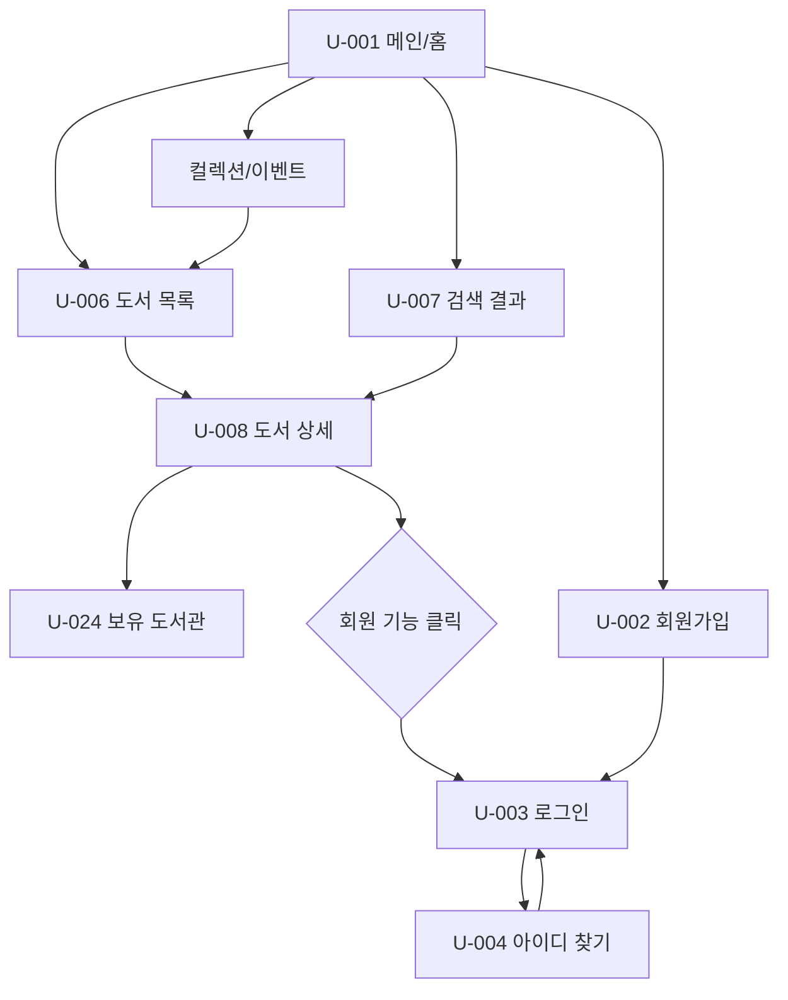
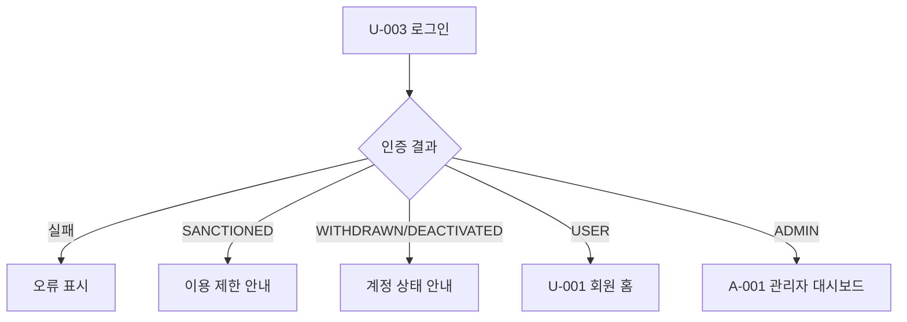
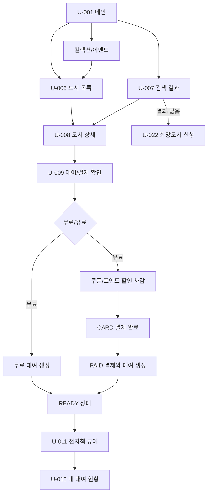
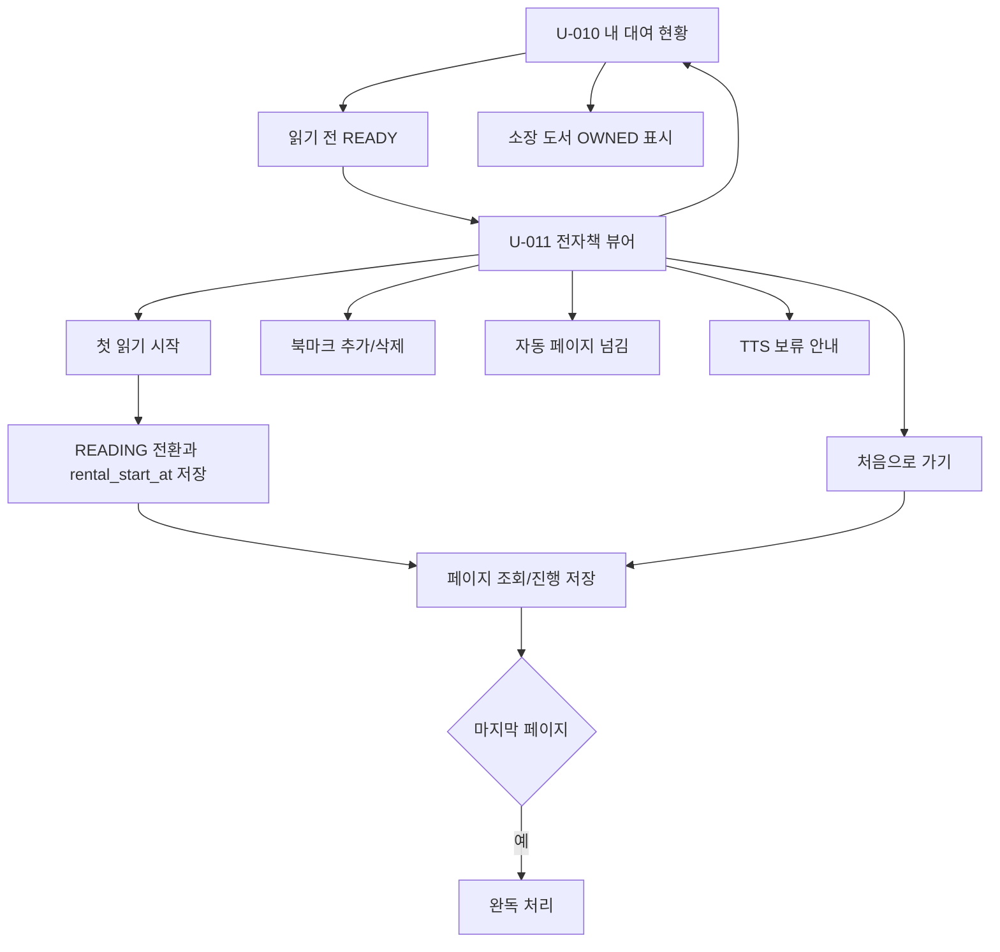
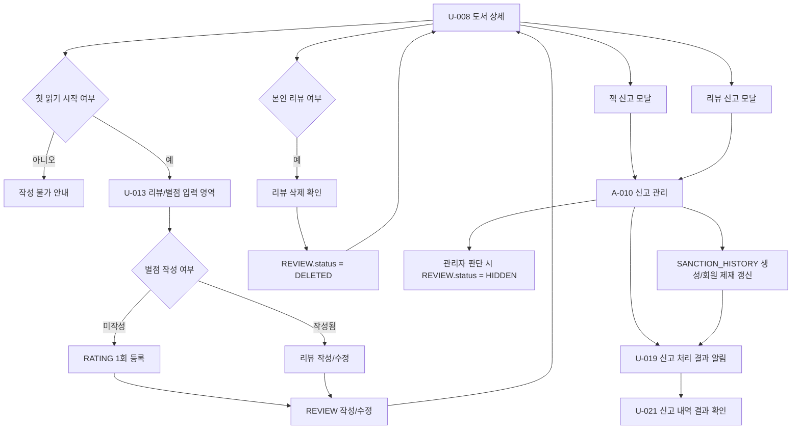
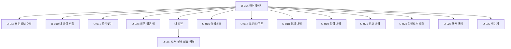
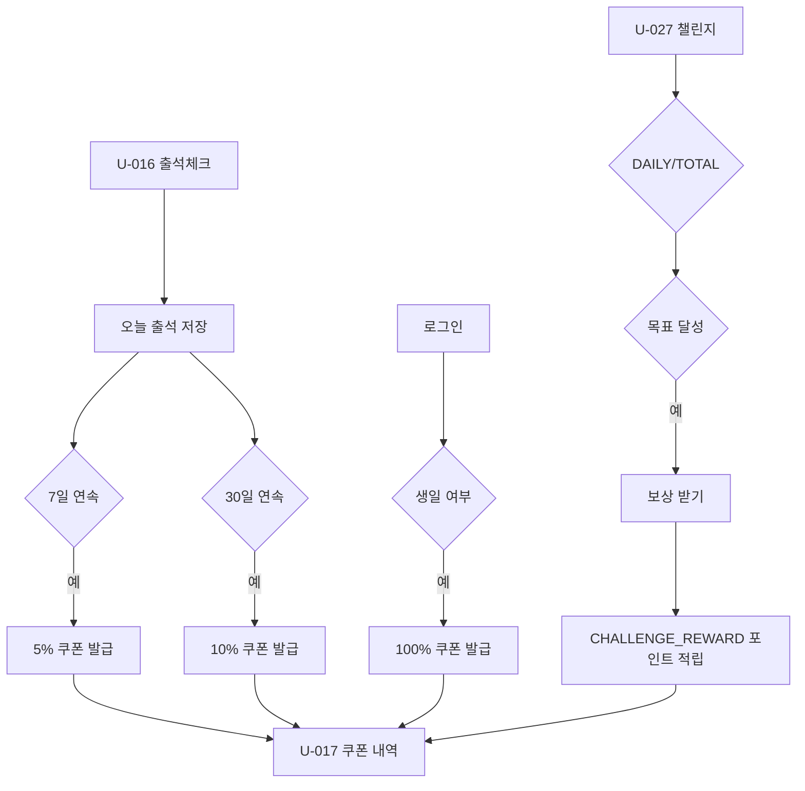
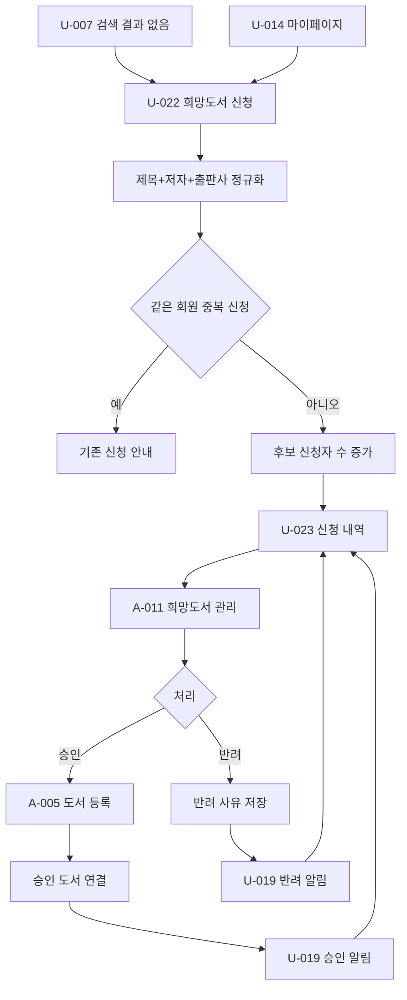
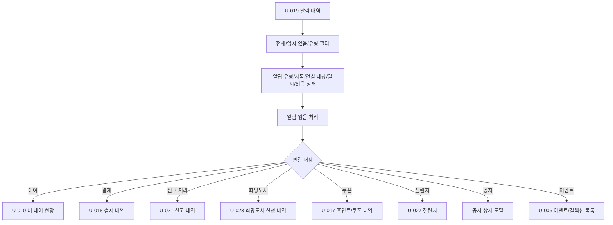
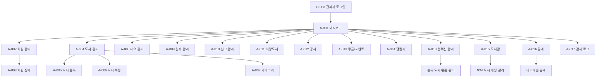

# ABC 전체 화면 이동 흐름

## 1. 비회원 핵심 흐름

비회원 비밀번호 재설정은 `api-spec(final).md` 기준 final 범위에서 제외한다. 로그인 회원의 비밀번호 변경은 `U-015 회원정보 수정`에서 `API-ME-003`으로 처리한다.

## 2. 로그인 권한 분기

## 3. 도서 탐색과 대여

유료 대여는 결제 전 중단만 가능하다. 완료되지 않은 결제 이력은 저장하지 않으며 0원 결제가 되어도 `PAYMENT`를 저장한다.

## 4. 뷰어와 내 서재

대여 상태는 `READY`, `READING`, `OWNED`만 사용한다. 대여 기간 종료 후 다시 이용 가능한 도서는 `READY` 기준으로 재대여한다. 처음으로 가기 실행 시 `READING_PROGRESS.current_page`를 1로 갱신한다.

## 5. 리뷰와 신고

신고는 책과 리뷰만 접수한다. 리뷰와 별점은 각각 회원+도서 기준 1개만 허용한다. 별점은 생성 후 수정/삭제할 수 없고, 리뷰 삭제와 관리자 숨김 상태를 분리한다.

## 6. 마이페이지 흐름

마이페이지의 내 리뷰는 `REVIEW`와 `RATING` 기준으로 표시하고, 수정/삭제는 `U-008`의 리뷰 영역으로 연결한다. 포인트 이력은 `POINT_HISTORY`, 쿠폰 만료일과 만료 예정 여부는 `MEMBER_COUPON.expires_at` 기준으로 목록에서 표시한다.

## 7. 출석과 챌린지 보상

포인트 이력 유형은 `CHALLENGE_REWARD`, `REVIEW_REWARD`, `PAYBACK`, `EVENT_REWARD`, `PAYMENT_USE`, `ADMIN_ADJUST`만 사용한다. 챌린지는 `DAILY`, `TOTAL`만 운영한다.

## 8. 희망도서 흐름

희망도서는 후보 단위로 집계하고, 관리자 화면은 후보 제목/저자/출판사, 신청자 수, 최초 신청일, 후보 상태, 신청자 목록을 표시한다. 검토 중은 후보 상태 `IN_REVIEW`로만 저장하고 회원별 신청 row에는 저장하지 않는다.

## 9. 알림 내역

알림 본문은 저장하지 않는다. `U-019` 목록 UI는 제목, 유형, 연결 대상, 읽음 상태, 일시만 표시하며 이벤트는 `EVENT` target으로 `U-006?section=event` 또는 `U-006?collectionId={id}`에 연결한다.

## 10. 관리자 전체 흐름

## 11. 화면 이동 예외

| 상황 | 처리 |
|---|---|
| 비회원이 회원 전용 버튼 클릭 | 로그인 안내 모달 후 `U-003` |
| 로그인 후 이전 목적 화면 존재 | 로그인 성공 후 원래 목적 화면으로 복귀 |
| 제재 회원이 대여/리뷰/신고 시도 | 이용 제한 안내, 현재 화면 유지 |
| 대여 기간 종료 후 뷰어 진입 | 재대여 안내 후 `U-010` |
| 일반 회원이 Admin URL 접근 | 권한 없음 후 `U-001` |
| 탈퇴/비활성 회원 로그인 | 로그인 거부와 계정 상태 안내 |

## 12. 화면 ID 제외 항목

| ID | 제외 이유 |
|---|---|
| `U-005` | 비회원 비밀번호 재설정은 `api-spec(final).md` final 범위에서 제외. 로그인 회원 비밀번호 변경은 `U-015`/`API-ME-003`에서 처리 |
| `U-020` | 신고는 `U-008` 내부 모달로 처리 |

`U-005`는 active 화면에서 제외한다. 도서 상세에는 대여, 리뷰/별점, 책/리뷰 신고, 추천 도서, 보유 도서관 위치 연결만 둔다.
